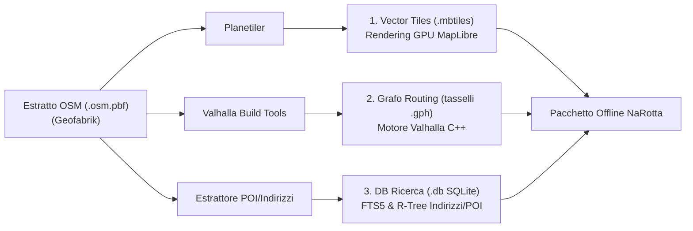
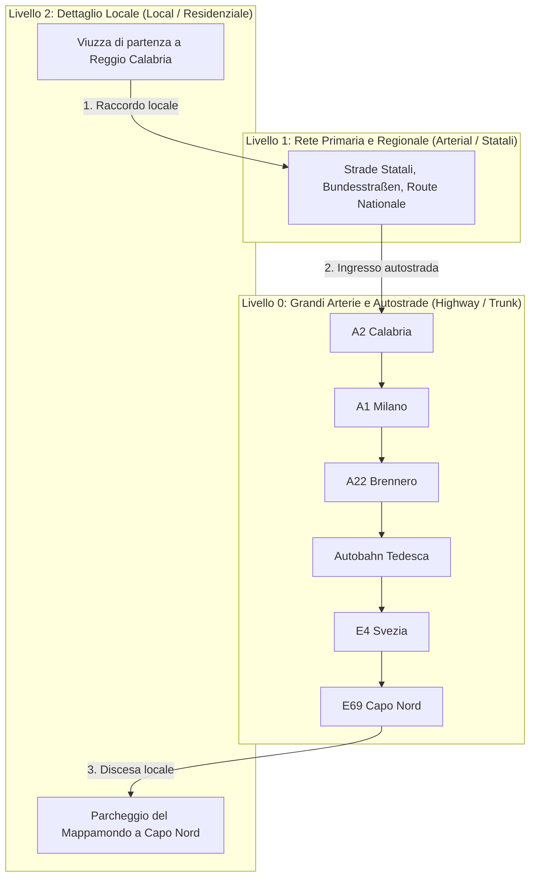
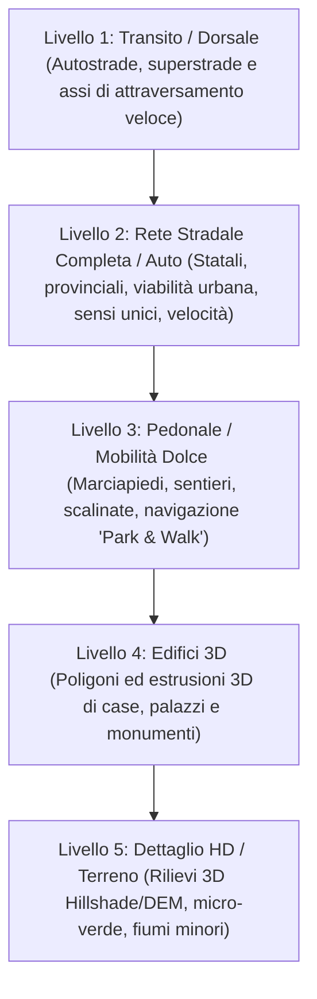
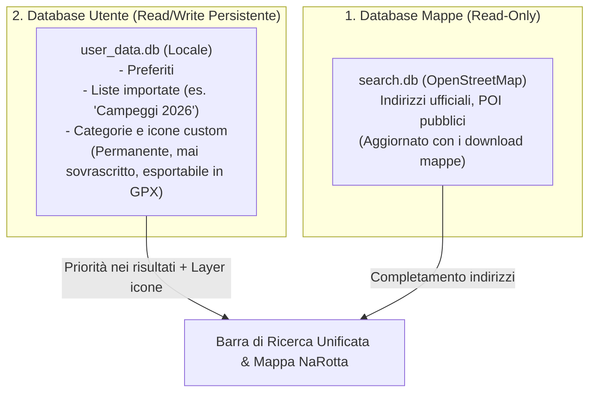
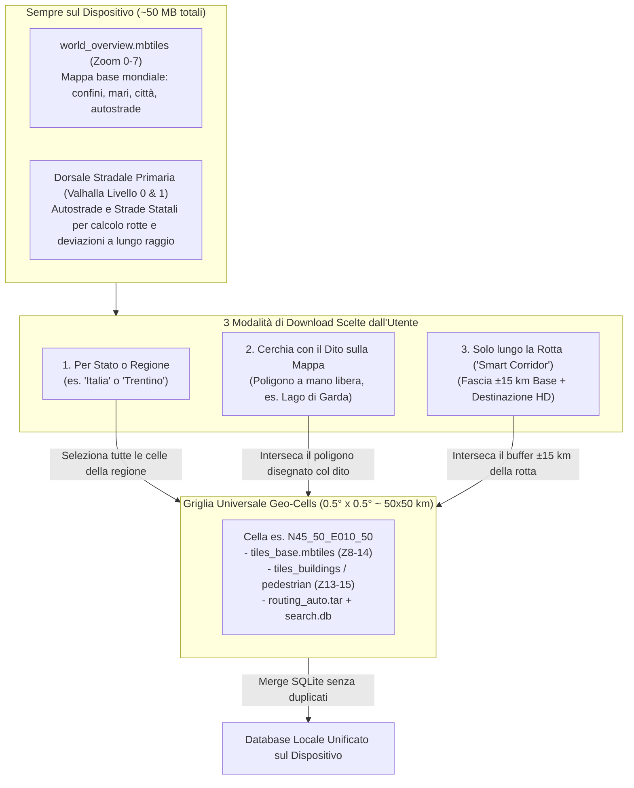
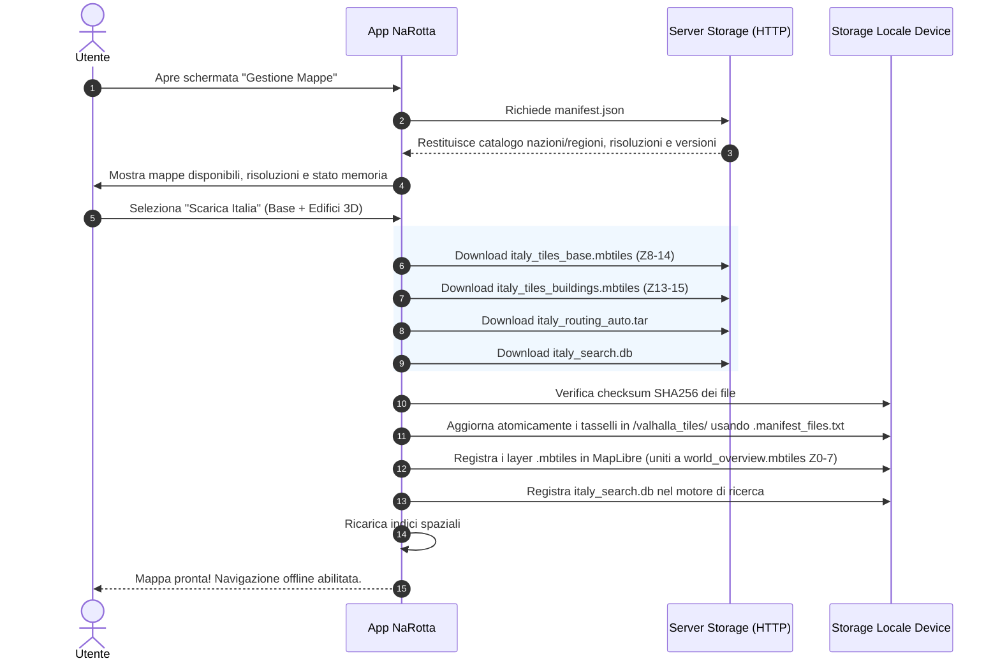

# 01 - Pipeline e Servizio di Download/Creazione Mappe

Questo documento definisce l'architettura, le tecnologie, i vincoli topologici e le stime volumetriche per il **servizio di download e preparazione delle mappe offline** per l'applicazione **NaRotta**.

---

## 1. Obiettivo e Requisiti

Per consentire la navigazione cartografica e il ricalcolo dei percorsi senza alcuna connessione di rete, l'applicazione mobile necessita di dati geografici pre-elaborati e ottimizzati per l'hardware degli smartphone e dei tablet.

I dati grezzi di OpenStreetMap (`.osm.pbf`) contengono l'intera topologia mondiale ma non possono essere interrogati a runtime direttamente dal dispositivo mobile per ragioni di efficienza e memoria.

### I 3 Componenti di una Regione Offline
Per ogni unità geografica scaricabile dall'utente (Regione o Nazione), il servizio genera **tre artefatti dedicati**:



1. **Vector Tiles (`.mbtiles` o `.pmtiles`)**:
   - Usato da: **MapLibre Native**.
   - Contenuto: Geometrie vettoriali (strade, fiumi, boschi, edifici, confini) strutturate a livelli di zoom secondo lo standard *OpenMapTiles*.
   - Rendering: Accelerato via GPU su mobile, con stile grafico personalizzato (`style.json`).

2. **Grafo di Routing (Tasselli `.gph` / `tiles.tar`)**:
   - Usato da: **Valhalla C++ Core**.
   - Contenuto: Grafo stradale gerarchico a celle (*tiled hierarchy*) con sensi unici, velocità storiche, restrizioni di svolta, pendenze e manovre.
   - Caratteristica chiave: Caricamento a memoria on-demand (30–60 MB RAM), perfetto per dispositivi mobili.

3. **Database di Ricerca Offline (`search.db`)**:
   - Usato da: Motore di ricerca interno di NaRotta.
   - Contenuto: Tabella SQLite con estensione **FTS5** (Full Text Search) per cercare città, vie e numeri civici, e **R-Tree** per trovare POI vicini (benzinai, colonnine di ricarica, parcheggi, farmacie, ristoranti).

---

## 2. Fonte dei Dati: Geofabrik

La fonte dati prescelta è il servizio di mirror ed estrazione di **Geofabrik** (`download.geofabrik.de`):
- **Costo/Licenza**: Gratuito, licenza Open Database License (ODbL).
- **Aggiornamento**: Giornaliero (dump notturno sincronizzato con i dati globali di OSM).
- **Parzializzazione geografica**:
  - Continenti: `europe`
  - Nazioni: `italy`, `germany`, `france`, `norway`, ecc.
  - Sub-regioni: suddivisioni amministrative (es. `trentino-alto-adige-latest.osm.pbf`, `lombardia-latest.osm.pbf`).
- **Integrità topologica**: Geofabrik garantisce che gli elementi a cavallo di confine (autostrade, ponti, valichi) mantengano i nodi necessari senza "spezzarsi" in modo anomalo.

---

## 3. Strumenti Software della Pipeline

Tutti gli strumenti selezionati sono **open-source e gratuiti**:

| Strumento | Scopo | Licenza | Perché è stato scelto |
| :--- | :--- | :--- | :--- |
| **Planetiler** | Generazione Vector Tiles | Apache-2.0 | Scritto in Java, genera un intero file `.mbtiles` in pochi minuti direttamente su disco/RAM senza richiedere un database PostgreSQL/PostGIS. |
| **Valhalla Tools** | Compilazione Grafo Routing | MIT | Strumenti ufficiali (`valhalla_build_tiles`, `valhalla_build_config`, `valhalla_build_extract`) per produrre i grafi gerarchici a tasselli compatibili al 100% con il core mobile di Valhalla. |
| **Osmium Tool / Python Osmium** | Filtro ed estrazione POI | GPL-3.0 / BSD | Tool C++ ultra-veloce per manipolare file `.osm.pbf`, unire regioni e filtrare tag specifici. |
| **SQLite3 + FTS5** | DB Ricerca Locale | Public Domain | Leggero, nativo su tutti i sistemi operativi mobile, zero runtime extra. |

---

## 4. Routing Multi-Regione e Continuità Topologica

Uno dei requisiti cardine è la possibilità di navigare tra territori adiacenti (es. da **Trento a Milano** attraverso Trentino, Veneto e Lombardia).

### Differenza tra Grafica e Routing ai Confini
- **Visualizzazione Grafica (MapLibre)**: La grafica non soffre di vincoli topologici. MapLibre può visualizzare più file `.mbtiles` contemporaneamente o visualizzare i layer affiancati senza interruzioni percepibili.
- **Motore di Routing (Valhalla)**: Il routing richiede un grafo continuo. Una strada che attraversa un confine regionale (es. la A22 o la statale SS12 tra Trentino e Veneto) deve avere il nodo finale nella regione A connesso al nodo iniziale nella regione B.

### Regole per il Routing Multi-Regione
1. **Continuità Geografica Obbligatoria**: Per calcolare un tragitto da Trento a Milano via autostrada (A22 ➔ A4), l'utente **deve** possedere i dati di tutte le regioni attraversate (Trentino, Veneto e Lombardia). Se il Veneto manca, il motore cercherà un tragitto alternativo attraverso i territori posseduti (es. Passo del Tonale direttamente tra Trentino e Lombardia) o restituirà errore se non esistono varchi collegati.
2. **Spazio ID Nodi Coerente**: I tasselli di routing di regioni adiacenti devono essere generati a partire da una build coerente (o macro-regionale/nazionale a monte), in modo che gli archi di confine condividano gli stessi identificativi di nodo (`GraphId`).
3. **Cartella Unificata sul Dispositivo (`/valhalla_tiles/`)**:
   - Sul dispositivo mobile, i tasselli estratti di ciascuna regione scaricata vengono memorizzati in una **cartella comune condivisa**.
   - Poiché la griglia di coordinate geografiche di Valhalla è globale e fissa (`level/x/y.gph`), non esistono collisioni di file tra regioni diverse.
   - Valhalla vede l'insieme delle regioni scaricate come un **unico territorio continuo**.

---

## 5. Routing a Lungo Raggio: La Struttura Gerarchica di Valhalla

Per viaggi continentali a lungo raggio (es. **dalla Calabria a Capo Nord**, oltre 4.500 km attraverso Italia, Austria/Svizzera, Germania, Danimarca, Svezia e Norvegia), un calcolo piatto (Dijkstra non gerarchico) causerebbe blocchi per memoria (OOM) o tempi di calcolo proibitivi.

Valhalla implementa nativamente una **gerarchia a 3 livelli**:



### Come Funziona il Calcolo di 4.500 km:
1. **Partenza**: L'algoritmo esplora il **Livello 2** per poche centinaia di metri attorno al punto di partenza fino a raggiungere una strada primaria (**Livello 1**).
2. **Salita a Livello 0**: In breve tempo la rotta si immette sull'autostrada e sale al **Livello 0**.
3. **Transito Continentale**: Per oltre 4.000 km, il motore opera **esclusivamente sui nodi del Livello 0**, ignorando l'intera rete urbana e secondaria di mezza Europa.
4. **Arrivo**: In prossimità della destinazione (Capo Nord), la ricerca riscende al Livello 2 per guidare l'utente fino al punto esatto.

👉 **Prestazioni garantite**: Anche su percorsi transcontinentali di oltre 4.500 km, il calcolo della rotta su smartphone richiede **meno di 1,5 secondi** e meno di **50–80 MB di RAM**.

---

## 6. Supporto a Profili di Guida e Opzioni di Costo ("No Autostrade")

L'algoritmo di routing supporta pienamente l'esclusione di specifiche categorie stradali tramite le `costing_options` di Valhalla:

```json
{
  "costing": "auto",
  "costing_options": {
    "auto": {
      "use_highways": 0.0,
      "use_tolls": 0.0,
      "use_ferries": 1.0,
      "use_living_streets": 0.1
    }
  }
}
```

### Comportamento con "No Autostrade" (`use_highways: 0.0`)
- **Tragitti Regionali (es. Trento ➔ Milano)**: Con Trentino, Veneto e Lombardia scaricate, il motore esclude la A22 e la A4 e calcola la rotta perfetta sulle sole **Strade Statali e Regionali** (es. SS12 dell'Abetone e del Brennero ➔ SR11 Padana Superiore via Peschiera, Desenzano e Brescia).
- **Tragitti a Lungo Raggio (es. Calabria ➔ Capo Nord)**: Per attraversare l'Europa senza autostrade, l'utente deve possedere la rete delle **Strade Statali / Nazionali (Livello 1)** dei paesi attraversati (es. *Bundesstraßen* in Germania, *Route Nationale* in Francia, *E-roads* secondarie in Scandinavia). Avendo a bordo l'intera rete stradale, il calcolo panoramico "No Autostrade" attraversa il continente con continuità assoluta.

---

## 7. Stima Volumetrica: Tutta Europa Offline in Locale

Nel caso in cui l'utente scelga di scaricare in locale **l'intera rete stradale e cartografica dell'Europa** (da Lisbona a Capo Nord, dall'Islanda alla Grecia) per navigare senza alcuna dipendenza dalla rete:

### Tabella Dimensioni Europa Completa

| Componente | Formato File | Dimensione Stimata | Descrizione e Dettaglio |
| :--- | :--- | :--- | :--- |
| **1. Mappa Grafica Vettoriale (MapLibre)** | `.mbtiles` | **25 – 30 GB** | Dettaglio completo da Zoom 0 a 14: fiumi, boschi, edifici 3D, rilievi, svincoli, toponimi e viabilità urbana. |
| **2. Grafo di Routing (Valhalla)** | Tasselli `.gph` / `tiles.tar` | **10 – 12 GB** | L'intera rete stradale europea (Livelli 0, 1 e 2): autostrade, statali, provinciali, viuzze residenziali, sensi unici e manovre. |
| **3. Ricerca Indirizzi & POI** | SQLite `search.db` (FTS5) | **5 – 7 GB** | Milioni di indirizzi, vie e punti di interesse (carburante, ricarica elettrica, farmacie, parcheggi, ristorazione). |
| **4. Modello di Elevazione (Opzionale)** | HGT / DEM | **2 – 3 GB** | Dati altimetrici per il calcolo delle pendenze stradali e visualizzazione 3D delle vette. |
| **TOTALE COMPLESSIVO** | | **~42 – 52 GB** | **Intero continente europeo memorizzato in locale.** |

*(Nota di ottimizzazione: Applicando un profilo di esportazione specifico per la navigazione veicolare che omette sentieri escursionistici montani estremi e arredi urbani non visibili dalla carreggiata, la grafica può essere ridotta a circa **18 – 20 GB**, portando il totale a **~35 GB**).*

### Perché 50 GB di Dati NON Rallentano il Dispositivo:
1. **Zero Impatto sulla RAM (< 100 MB costanti)**:
   - Né MapLibre né Valhalla caricano mai l'intero archivio in memoria.
   - Sfruttano una **cache LRU** che mantiene in RAM solo i tasselli dell'area visibile e dei 5–10 km attorno al veicolo.
   - Il consumo di memoria di NaRotta è identico sia con 200 MB che con 50 GB di mappe installate.
2. **Velocità di Lettura Flash (UFS 2.2 / 3.1 / NVMe)**:
   - I moderni smartphone leggono a velocità comprese tra 800 MB/s e 3.000 MB/s. Il caricamento dal disco di un singolo tassello da 150 KB richiede meno di **0,5 millisecondi**.
3. **Architettura di Download Modulare per Nazione**:
   - I dati vengono distribuiti pacchettizzati per Nazione (es. `italia.mbtiles`, `germania.mbtiles`, ecc.).
   - Tutti i tasselli di routing convergono nella medesima cartella locale `/valhalla_tiles/`.
   - **Vantaggio**: Quando le mappe dell'Italia vengono aggiornate il mese successivo, l'utente scarica solo i ~2.5 GB dell'Italia senza dover riscaricare tutti i 50 GB del continente.

---

## 8. Architettura Modulare a Livelli di Dettaglio (Layer Stack)

Per offrire all'utente il massimo controllo sullo spazio occupato e sulle prestazioni, i dati cartografici vengono strutturati secondo una **pila a livelli modulari (Layer Stack)**. I nomi e il numero di livelli rappresentano la suddivisione funzionale dei dati:



### Suddivisione Funzionale dei Livelli (Esempio a 5 Livelli)
1. **Transito**: Rete autostradale e grandi arterie primarie continentali/nazionali. Ideale per attraversare territori di passaggio con consumo di memoria prossimo allo zero.
2. **Solo Auto (Rete Carrabile)**: Tutta la viabilità aperta al traffico veicolare, dai tornanti di montagna alle viuzze di quartiere, inclusi sensi unici, rotonde e divieti. È il cuore della guida pura.
3. **Pedonale / Mobilità Dolce**: Percorsi pedonali, scalinate storiche, marciapiedi, piste ciclabili e routing pedonale. Fondamentale per la funzione *"Park & Walk"* (guida l'auto fino al parcheggio e prosegue a piedi fino al portone di arrivo).
4. **Edifici 3D**: Poligoni 2D ed estrusioni tridimensionali dei fabbricati urbani. Aiuta il riconoscimento visivo degli incroci in città.
5. **Dettaglio HD**: Rilievi altimetrici 3D (Hillshade/DEM), idrografia secondaria, texture e micro-verde per un'esperienza visiva ad alta fedeltà.

---

## 9. Disaccoppiamento della Ricerca Indirizzi & POI (Sempre Full)

A differenza della grafica e del routing che possono essere scaricati a livelli o per singola zona, il **motore di ricerca (Indirizzi & Punti di Interesse)** viene mantenuto **sempre completo e indipendente**:
- **Ingombro contenuto**: Grazie alla compressione e all'indicizzazione SQLite FTS5 (Full-Text Search) e R-Tree, l'intero database di indirizzi e POI di una nazione occupa uno spazio molto ridotto (~200–300 MB per l'Italia, ~2–3 GB per l'Europa).
- **Cerca ovunque in qualsiasi momento**: L'utente può cercare qualunque indirizzo, ristorante, hotel o distributore anche prima di aver scaricato la mappa grafica o il routing di quell'area.
- **Flusso proattivo**: Individuata la destinazione tramite ricerca, l'applicazione conosce le coordinate `(lat, lon)` e può proporre all'utente di scaricare il livello di dettaglio desiderato per quella specifica zona.

---

## 10. POI Personalizzati e Importazione da Fonti Esterne

Per consentire a camperisti, motociclisti e viaggiatori di arricchire la mappa con banche dati dedicate (es. campeggi, aree di sosta, punti panoramici, fontanelle, mete personali o archivi offline come Park4Night/ACSI), NaRotta integra un sistema di gestione POI personalizzati.

### A. Formati di File Supportati per l'Importazione
- **GPX (`.gpx`)**: Standard universale per waypoint e rotte (da Garmin, OsmAnd, Komoot, Wikiloc).
- **KML / KMZ (`.kml`, `.kmz`)**: Formato di Google Earth e Google My Maps.
- **GeoJSON (`.geojson`)**: Formato moderno per geometrie e proprietà strutturate.
- **CSV / TSV (`.csv`)**: Tabelle con colonne `Latitudine`, `Longitudine`, `Nome`, `Descrizione`, `Categoria`.

### B. Separazione Rigida dei Database: `System` vs `User`
Per garantire che gli aggiornamenti periodici delle mappe non cancellino o sovrascrivano i dati dell'utente, l'architettura separa nettamente i due database:



1. **Database di Sistema (`search.db`)**:
   - In sola lettura, generato dalla pipeline a partire da OpenStreetMap.
   - Viene sostituito quando l'utente aggiorna la mappa della regione o dello stato.
2. **Database Utente (`user_data.db`)**:
   - Risiede nello storage persistente dell'applicazione.
   - Conserva categorie, preferiti, waypoint importati, note e foto personali.
   - **Non viene mai toccato dagli aggiornamenti delle mappe**.
   - È esportabile in qualsiasi momento come file `.gpx` per backup o condivisione.

### C. Integrazione con Mappa, Ricerca e Guida
- **Visualizzazione su MapLibre**: I POI dell'utente vengono proiettati sulla mappa come un layer vettoriale GeoJSON dinamico, con icone tematiche (es. tenda per campeggi, stella per preferiti) e toggle di accensione/spegnimento per singola categoria.
- **Ricerca con Priorità**: La barra di ricerca unifica i risultati: i POI personali compaiono in cima alla lista con tag visivo dedicato.
- **Navigazione Istantanea**: Toccando il marker, la scheda mostra i dettagli e il pulsante *"Naviga qui"*, passando direttamente le coordinate `(lat, lon)` al motore Valhalla.
- **Avviso di Prossimità**: Funzione opzionale per avvisare con segnale sonoro/visivo quando ci si trova a breve distanza da un POI personale lungo l'itinerario.

---

## 11. Le 3 Modalità di Download nell'App NaRotta e la Griglia a Celle (`0.5° × 0.5°`)

Per consentire all'utente di scaricare non solo interi stati o regioni, ma anche **aree libere disegnate con il dito sulla mappa globale** oppure **soltanto il corridoio dettagliato lungo la propria rotta**, NaRotta affianca ai pacchetti regionali una **Griglia Geografica Universale a Celle (`Geo-Cells` di `0.5° × 0.5°`, circa `50 km × 50 km`)**.



### Le 3 Modalità di Selezione Utente

1. **Modalità 1 — Per Stato o Regione Amministrativa**:
   - L'utente seleziona una nazione o una regione dal catalogo (con l'opzione *"Scarica sempre tutto al massimo dettaglio"* oppure scegliendo i singoli layer).
   - Poiché ogni regione è mappata sulle celle `0.5° × 0.5°` che la compongono, **non si scaricano mai dati duplicati**: se l'utente aveva già scaricato alcune celle tramite un cerchio col dito o una rotta precedente, l'app scarica solo le celle mancanti.
2. **Modalità 2 — "Cerchia con il Dito" sulla Mappa Globale (Lasso / Freehand Area)**:
   - Ideale per zone di confine o mete turistiche a cavallo tra più regioni/stati (es. **Lago di Garda** diviso tra Lombardia, Veneto e Trentino, oppure **Dolomiti / Alpi di confine**).
   - L'utente disegna col dito un cerchio o un poligono libero sopra la mappa base globale (`world_overview.mbtiles`).
   - L'app calcola istantaneamente le celle `0.5° × 0.5°` intersecate dal disegno, mostra il peso esatto in MB e scarica solo quei quadrati.
3. **Modalità 3 — "Dettaglio solo lungo la Rotta e Mappa Base per il resto" (Smart Route Corridor)**:
   - Ideale per lunghi viaggi attraverso più nazioni (es. **Milano ➔ Parigi** o **Calabria ➔ Capo Nord**).
   - Calcolata la rotta, l'utente sceglie *"Scarica solo per questa rotta"*:
     - **Tutto il resto dei paesi attraversati**: resta coperto dalla **Mappa Base (`world_overview` Z0–7)** + **Dorsale Stradale (Valhalla Livello 0 Autostrade + Livello 1 Statali)** a costo di memoria quasi nullo.
     - **Corridoio della Rotta (fascia di ±15 km a destra e sinistra del percorso)**: l'app scarica automaticamente le celle `0.5° × 0.5°` toccate dal corridoio in risoluzione **Base Guida (Z8–14 + viabilità locale Livello 2 + distributori/POI)**. Il margine di ±15 km (30 km totali) insieme alla rete statale garantisce il ricalcolo immediato anche in caso di chiusure autostradali e deviazioni impreviste.
     - **Destinazione e Tappe (raggio ±10 km)**: l'app scarica automaticamente anche i layer **Alta Risoluzione HD (`buildings_3d` + `pedestrian` Z13–15)** solo sulle celle di arrivo/sosta per la navigazione urbana 3D e pedonale *"Park & Walk"*.
4. **Evidenziazione Visiva sulla Mappa**:
   - Facendo zoom-out sulla mappa base, l'app mostra un contorno semitrasparente sulle celle e sui corridoi attualmente installati in alta risoluzione, così l'utente distingue sempre a colpo d'occhio le aree ad alto dettaglio dalla mappa base.

---

## 12. Architettura Multi-Risoluzione e Catalogo `manifest.json`

### Strategia Combinata: Zoom Piramidale + Layer Funzionali
Per garantire fluidità a ogni scala geografica (dal continente intero al singolo incrocio) senza sprechi di spazio, le mappe vettoriali sono suddivise combinando **risoluzione di zoom** e **layer funzionali**:

1. **Risoluzione Panoramica Globale (`world_overview.mbtiles`, Zoom 0 – 7)**:
   - Contiene confini nazionali, linee di costa, mari, grandi laghi, autostrade principali (`motorway`/`trunk`) e capitali/metropoli.
   - Dimensione ultra-compatta (~15–40 MB), sempre presente sul dispositivo per evitare "buchi bianchi" durante lo zoom-out fuori dalle regioni o dai corridoi scaricati.
2. **Risoluzione Regionale/Cella Base (`tiles_base.mbtiles`, Zoom 8 – 14)**:
   - Contiene la rete stradale carrabile completa con semplificazione geometrica progressiva:
     - **Zoom 8–9**: Autostrade, superstrade e capoluoghi.
     - **Zoom 10–11**: Strade statali (`primary`), provinciali (`secondary`), fiumi e comuni.
     - **Zoom 12–13**: Viabilità urbana (`tertiary`, `residential`), quartieri e aree verdi.
     - **Zoom 14**: Dettaglio completo di navigazione (corsie, rotonde, svincoli, sensi unici, tutti i toponimi stradali), renderizzato con *overzoom* vettoriale nitido fino a Zoom 18–20.
3. **Risoluzione Alta / Pacchetti HD Opzionali (Zoom 13 – 15)**:
   - `tiles_pedestrian.mbtiles` (Zoom 13–15): Sentieri, marciapiedi, piste ciclabili e scalinate.
   - `tiles_buildings.mbtiles` (Zoom 13–15): Poligoni ed altezze per l'estrusione 3D degli edifici.
   - `tiles_terrain_hd.mbtiles` (Zoom 9–14): Rilievi altimetrici 3D (DEM / curve di livello) e idrografia minore.

### Convenzione di Naming dei File (Regioni + Griglia `cells/`)
```text
storage/
├── manifest.json
├── assets/
│   └── map_assets.zip                        # Font PBF offline (0-255.pbf), Sprites e style-day/night.json
├── overview/
│   └── world_overview.mbtiles                # Mappa panoramica globale/continentale (Zoom 0-7)
├── cells/                                    # Celle modulari 0.5° x 0.5° per selezione col dito e corridoi rotta
│   └── N45_50_E010_50/                       # Esempio: Cella Lago di Garda (Lat 45.50..46.00, Lon 10.50..11.00)
│       ├── N45_50_E010_50_tiles_base.mbtiles
│       ├── N45_50_E010_50_tiles_pedestrian.mbtiles
│       ├── N45_50_E010_50_tiles_buildings.mbtiles
│       └── N45_50_E010_50_tiles_terrain_hd.mbtiles
└── regions/
    └── europe/
        └── italy/
            ├── italy_search.db               # Ricerca & POI Full (SQLite FTS5 + R-Tree)
            ├── italy_routing_auto.tar        # Grafo di routing carrabile (.gph + .manifest_files.txt)
            ├── italy_routing_pedestrian.tar  # Grafo di routing pedonale (opzionale)
            ├── italy_tiles_base.mbtiles      # Grafica Transito + Auto (Zoom 8-14)
            ├── italy_tiles_pedestrian.mbtiles # Layer marciapiedi e sentieri (Zoom 13-15)
            ├── italy_tiles_buildings.mbtiles  # Layer edifici 3D (Zoom 13-15)
            └── italy_tiles_terrain_hd.mbtiles # Layer rilievi altimetrici HD (Zoom 9-14)
```

### Struttura del Catalogo `manifest.json` Modulare (v2.2 con Geo-Cells)
```json
{
  "schema_version": "2.2",
  "generated_at": "2026-10-18T17:00:00Z",
  "base_url": "https://storage.narotta.app/maps/",
  "cell_size_degrees": 0.5,
  "overview": {
    "filename": "overview/world_overview.mbtiles",
    "min_zoom": 0,
    "max_zoom": 7,
    "size_bytes": 41943040,
    "sha256": "a1b2c3...98f0"
  },
  "assets": {
    "filename": "assets/map_assets.zip",
    "version": "20261018",
    "size_bytes": 6291456,
    "sha256": "d4e5f6...11a2"
  },
  "regions": [
    {
      "id": "europe/italy",
      "parent_id": "europe",
      "country_code": "IT",
      "name": "Italia",
      "version": "20261018",
      "bbox": [6.62, 35.49, 18.52, 47.09],
      "cell_ids": ["N45_00_E009_00", "N45_50_E010_50", "..."],
      "search": {
        "filename": "regions/europe/italy/italy_search.db",
        "size_bytes": 262144000,
        "sha256": "f9a4b3...12c5"
      },
      "layers": {
        "transit_and_driving": {
          "description": "Rete stradale completa (Z8-14) e routing auto/moto",
          "min_zoom": 8,
          "max_zoom": 14,
          "tiles": "regions/europe/italy/italy_tiles_base.mbtiles",
          "tiles_size_bytes": 629145600,
          "tiles_sha256": "7c8d9e...001a",
          "routing": "regions/europe/italy/italy_routing_auto.tar",
          "routing_size_bytes": 367001600,
          "routing_sha256": "3b4c5d...882b"
        }
      }
    }
  ],
  "cells": [
    {
      "cell_id": "N45_50_E010_50",
      "bbox": [10.5, 45.5, 11.0, 46.0],
      "layers": {
        "transit_and_driving": {
          "min_zoom": 8,
          "max_zoom": 14,
          "tiles": "cells/N45_50_E010_50/N45_50_E010_50_tiles_base.mbtiles",
          "tiles_size_bytes": 12582912,
          "tiles_sha256": "4f5e6d...110a"
        },
        "buildings_3d": {
          "min_zoom": 13,
          "max_zoom": 15,
          "tiles": "cells/N45_50_E010_50/N45_50_E010_50_tiles_buildings.mbtiles",
          "tiles_size_bytes": 8388608,
          "tiles_sha256": "8a9b0c...221b"
        }
      }
    }
  ]
}
```

---

## 13. Gestione delle 7 Criticità Tecniche della Pipeline Offline

Per garantire un funzionamento impeccabile nel mondo reale, la pipeline risolve nativamente sette problematiche critiche della cartografia offline:

1. **Prevenzione dei "Bordi Tagliati" nei Vector Tiles (`.mbtiles`) ai Confini Regionali**:
   - I tasselli Web Mercator (`z/x/y`) sono quadrati, mentre i confini amministrativi sono poligoni irregolari.
   - Quando si compila una macro-area (es. `italy`) e si effettua lo split per sub-regioni (es. `lombardia`, `veneto`), i tasselli `z/x/y` che intersecano il confine vengono estratti già completi su entrambi i lati.
   - Lato dispositivo, i file `.mbtiles` dello stesso layer possono essere uniti in un database SQLite locale (`INSERT OR REPLACE INTO tiles`) o serviti tramite un `TileProvider` unificato senza mai creare vuoti bianchi ai confini.
2. **Continuità Trans-Nazionale del Routing (es. Brennero: Italia ➔ Austria)**:
   - Per mantenere gli stessi `GraphId` sugli archi stradali transfrontalieri, la build di produzione di Valhalla viene eseguita sull'estratto continentale (`europe-latest.osm.pbf`) e successivamente affettata per nazione/regione tramite poligoni `.poly`/GeoJSON dal servizio `ValhallaTileSplitterService`.
3. **Risoluzione Spaziale "Via ➔ Comune" (Point-in-Polygon) nel DB di Ricerca**:
   - Circa l'80% degli archi stradali (`highway=*`) in OpenStreetMap non possiede il tag `addr:city`.
   - Il costruttore C# di `search.db` esegue una pipeline a due passaggi con **NetTopologySuite (`STRtree`)**: nel primo passaggio indicizza in memoria i poligoni dei confini amministrativi comunali (`admin_level=8`) e i centri abitati; nel secondo passaggio assegna a ogni via e POI il comune di appartenenza tramite test *Point-in-Polygon* sul centroide e deduplica i segmenti contigui della stessa via.
4. **Integrazione Dati Altimetrici DEM (`.hgt` SRTM / Copernicus)**:
   - Poiché i file `.osm.pbf` non contengono né curve di livello né modelli digitali di elevazione, il servizio `DemElevationService` scarica le celle altimetriche `.hgt` per la bounding box della regione, alimentando sia `valhalla_build_elevation` (pendenze stradali) sia la generazione del layer `terrain_hd`.
5. **Font PBF (Glyphs) e Icone (Sprites) Offline per MapLibre**:
   - Per evitare che MapLibre tenti connessioni di rete per scaricare i caratteri tipografici, il comando `build-assets` produce il pacchetto `map_assets.zip` con i font convertiti in range `.pbf` (`0-255.pbf`), gli sprites degli scudetti autostradali e gli stili `style-day.json` / `style-night.json` con URI locali.
6. **Hardware Profiler Automatico (RAM vs Memory-Mapped SSD)**:
   - Prima di lanciare Planetiler o Valhalla, la CLI C# rileva la RAM fisica libera della macchina (Windows o Linux). Se la memoria disponibile è inferiore alla soglia richiesta dal `.osm.pbf`, imposta automaticamente `--nodemap-type=sparsearray` e `--storage=mmap` su disco NVMe/SSD per prevenire errori di `OutOfMemory`.
7. **Aggiornamento e Rimozione Atomica dei Tasselli di Routing (`.manifest_files.txt`)**:
   - Ogni archivio `<region>_routing_auto.tar` include un indice `.manifest_files.txt` con l'elenco esatto dei file `.gph` contenuti. Quando l'utente aggiorna o rimuove una regione, l'app mobile elimina i tasselli obsoleti prima di scompattare la nuova versione nella cartella condivisa `/valhalla_tiles/`.

---

## 14. Applicazione CLI Cross-Platform in C# (.NET 10): `NaRotta.MapBuilder`

La pipeline di scaricamento e conversione è implementata come applicazione CLI multipiattaforma in **C# (.NET 10)** situata nella directory `map-builder/` (documentata nel dettaglio in [`02_architettura_map_builder.md`](02_architettura_map_builder.md)):

```text
map-builder/
├── NaRotta.MapBuilder.sln
├── profiles/                         # Schemi YAML Planetiler per le varie risoluzioni e template Valhalla
└── src/
    └── NaRotta.MapBuilder.Cli/       # Applicazione CLI C# (.NET 10) per Windows e Linux/Unix
```

---

## 15. Flusso di Utilizzo lato App Mobile (NaRotta)



