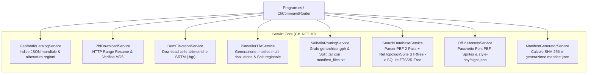
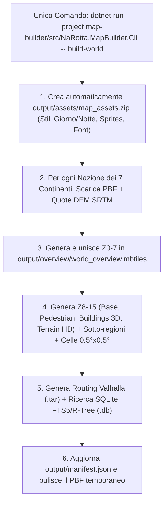

# 02 - Architettura Tecnica `NaRotta.MapBuilder` (C# .NET 10 CLI)

Questo documento descrive l'architettura software, gli algoritmi di conversione, gli schemi SQLite e il funzionamento multipiattaforma (Windows e Linux/Unix) dell'applicazione **`NaRotta.MapBuilder`**, incaricata di scaricare i dati OpenStreetMap/DEM e compilare i pacchetti offline multi-risoluzione per **NaRotta**.

---

## 1. Stack Tecnologico e Compatibilità Multipiattaforma

L'applicazione è sviluppata in **C# su .NET 10 (`net10.0`)** come CLI eseguibile nativamente su:
- **Windows (`win-x64`, `win-arm64`)**
- **Linux / Unix (`linux-x64`, `linux-arm64`, `osx-arm64`)**

### Dipendenze Principali (.NET NuGet)
| Pacchetto NuGet | Scopo nell'Architettura |
| :--- | :--- |
| **`OsmSharp`** | Parsing ad alte prestazioni di stream binari `.osm.pbf` (Nodi, Way, Relation) in C# nativo. |
| **`NetTopologySuite`** | Geometrie vettoriali OGC, calcolo centroidi, poligoni amministrativi e indice spaziale in-memory `STRtree` per l'associazione *Point-in-Polygon* (Via ➔ Comune). |
| **`Microsoft.Data.Sqlite`** | Creazione e popolamento diretto dei database SQLite (`search.db` con FTS5 e R-Tree, e manipolazione `.mbtiles`). |

### Esecuzione dei Tool Esterni (`CrossPlatformProcessRunner`)
Per i componenti esterni della pipeline, `CrossPlatformProcessRunner` astrae il sistema operativo ospite:
1. **Planetiler (Java `.jar`)**:
   - Viene scaricato automaticamente nella directory `tools/` se assente.
   - Viene eseguito nativamente tramite `java -jar planetiler.jar` sia su Windows sia su Linux, calibrando dinamicamente il flag `-Xmx` e la modalità di storage (`ram` vs `mmap`) in base alla RAM rilevata da `HardwareProfilerService`.
2. **Valhalla Build Tools (`valhalla_build_tiles`, `valhalla_build_elevation`)**:
   - Su **Linux / Unix**: invocazione diretta dei binari nativi (con fallback automatico su Docker se non installati globalmente).
   - Su **Windows**: invocazione trasparente tramite **WSL2** (`wsl -- ...`) con conversione automatica dei path Windows in path mount WSL (`/mnt/c/...`), oppure tramite **Docker Desktop** (`ghcr.io/valhalla/valhalla-scripted:latest`).

---

## 2. Architettura dei Moduli C#



---

## 3. Pipeline Multi-Risoluzione dei Vector Tiles (`.mbtiles`)

Per ottimizzare le prestazioni di rendering su MapLibre e consentire download granulari, `PlanetilerTileService` utilizza 5 profili di schema YAML nella cartella `profiles/`:

| Profilo | File Output | Range Zoom | Contenuto e Livello di Semplificazione |
| :--- | :--- | :--- | :--- |
| **`overview`** | `world_overview.mbtiles` | **Z0 – Z7** | Coste, mari, confini nazionali (`admin_level=2`), capitali, grandi metropoli e dorsali autostradali europee (`motorway`, `trunk`). |
| **`base`** | `<region>_tiles_base.mbtiles` | **Z8 – Z14** | Rete stradale carrabile progressiva (Z8-9 autostrade, Z10-11 statali/provinciali, Z12-13 urbane, Z14 dettaglio corsie/svincoli/sensi unici), idrografia, boschi, parchi e tutti i toponimi. |
| **`pedestrian`** | `<region>_tiles_pedestrian.mbtiles` | **Z13 – Z15** | Marciapiedi (`footway`), piste ciclabili (`cycleway`), sentieri escursionistici (`path`, `track`), scalinate (`steps`) e aree pedonali. |
| **`buildings`** | `<region>_tiles_buildings.mbtiles` | **Z13 – Z15** | Impronte poligonali degli edifici con attributi `render_height` e `render_min_height` per la vista 3D in navigazione. |
| **`terrain`** | `<region>_tiles_terrain_hd.mbtiles` | **Z9 – Z14** | Vette montane (`natural=peak` con quota `ele`), passi alpini (`mountain_pass`), sorgenti e linee altimetriche. |

### Gestione dei Confini nei File `.mbtiles` (`MbtilesSplitterService`)
Quando si esegue una build nazionale con il flag `--split-subregions`:
1. Planetiler compila il file `.mbtiles` dell'intera nazione (garantendo che i tasselli a cavallo tra due regioni contengano le geometrie complete di entrambe le regioni).
2. `MbtilesSplitterService` apre il file SQLite `.mbtiles` sorgente e, per ciascuna sotto-regione, calcola tutte le coordinate dei tasselli `(zoom_level, tile_column, tile_row)` che intersecano il poligono della regione, copiandole nel file `<subregion>_tiles_<layer>.mbtiles`.

---

## 4. Motore di Estrazione Ricerca Offline (`SearchDatabaseService`)

Il database `<region>_search.db` viene generato interamente in C# tramite una pipeline in due fasi progettata per superare l'assenza del tag `addr:city` sulla maggioranza delle strade OpenStreetMap:

### Fase 1: Indicizzazione dei Comuni e Centri Abitati
1. Scansione veloce del file `.osm.pbf` per estrarre i nodi e le relazioni con `place=city|town|village|hamlet|suburb` oppure `boundary=administrative` (`admin_level=8`).
2. Costruzione di un indice spaziale **`STRtree<AdminPlaceModel>`** in memoria tramite `NetTopologySuite`.

### Fase 2: Estrazione Strade, Numeri Civici e POI con Deduplicazione
1. Scansione delle `way` stradali (`highway=*` dotate di `name`) e dei nodi/poligoni con indirizzi (`addr:street`, `addr:housenumber`) o tag POI (`amenity`, `shop`, `tourism`, `highway=services|rest_area`).
2. Se l'elemento non possiede il tag esplicito `addr:city`, il servizio interroga l'`STRtree` in memoria con le coordinate `(lat, lon)` dell'elemento e risolve il comune più vicino/contenente.
3. **Deduplicazione Stradale**: i molteplici segmenti OSM appartenenti alla stessa via all'interno del medesimo comune (es. 25 tratti di *"Via Roma"* a *Trento*) vengono fusi in un unico record stradale con centroide mediano e bounding box complessiva.

### Schema SQLite di `<region>_search.db`
```sql
-- 1. Tabella Comuni e Località
CREATE TABLE places (
    id INTEGER PRIMARY KEY,
    osm_id INTEGER NOT NULL,
    name TEXT NOT NULL,
    place_type TEXT NOT NULL,
    postcode TEXT,
    admin_region TEXT,
    latitude REAL NOT NULL,
    longitude REAL NOT NULL,
    population INTEGER DEFAULT 0
);

-- 2. Tabella Strade (Deduplicate per Comune)
CREATE TABLE streets (
    id INTEGER PRIMARY KEY,
    place_id INTEGER,
    name TEXT NOT NULL,
    city_name TEXT NOT NULL,
    postcode TEXT,
    latitude REAL NOT NULL,
    longitude REAL NOT NULL
);

-- 3. Tabella Punti di Interesse (POI) e Numeri Civici
CREATE TABLE pois (
    id INTEGER PRIMARY KEY,
    osm_id INTEGER NOT NULL,
    category TEXT NOT NULL,
    sub_category TEXT NOT NULL,
    name TEXT NOT NULL,
    street_name TEXT,
    house_number TEXT,
    city_name TEXT,
    postcode TEXT,
    phone TEXT,
    website TEXT,
    opening_hours TEXT,
    latitude REAL NOT NULL,
    longitude REAL NOT NULL
);

-- 4. Indice Full-Text Search (FTS5) Unificato con rimozione accenti
CREATE VIRTUAL TABLE search_fts USING fts5(
    entity_type UNINDEXED,
    entity_id UNINDEXED,
    title,
    subtitle,
    tokens,
    latitude UNINDEXED,
    longitude UNINDEXED,
    tokenize = 'unicode61 remove_diacritics 2'
);

-- 5. Indice Spaziale R-Tree per ricerca POI di prossimità
CREATE VIRTUAL TABLE poi_rtree USING rtree(
    id,
    min_latitude,
    max_latitude,
    min_longitude,
    max_longitude
);
```

---

## 5. Grafo di Routing Valhalla e Slicing Regionale (`ValhallaRoutingService`)

1. **Generazione Configurazione**: viene generato `valhalla.json` impostando i limiti gerarchici dei 3 livelli (`0`: Highway/Trunk, `1`: Primary/Secondary, `2`: Local/Residential/Pedestrian).
2. **Altimetria DEM**: se abilitata, i file `.hgt` scaricati da `DemElevationService` vengono collocati in `elevation_data/` prima di invocare `valhalla_build_tiles`.
3. **Slicing Regionale e `.manifest_files.txt`**:
   - I tasselli `.gph` di Valhalla seguono una griglia geografica fissa:
     - Livello 0: celle di `4.0° x 4.0°`
     - Livello 1: celle di `1.0° x 1.0°`
     - Livello 2: celle di `0.25° x 0.25°`
   - `ValhallaRoutingService` calcola quali celle dei livelli `0`, `1` e `2` intersecano la bounding box/poligono della regione e crea l'archivio `<region>_routing_auto.tar` includendo il file `.manifest_files.txt` con l'elenco dei tasselli per consentire aggiornamenti atomici sul dispositivo mobile.

---

## 6. Slicing a Griglia `0.5° × 0.5°` (`GeoCellGridService`): Selezione col Dito e Corridoio Rotta

Per permettere all'utente sull'app NaRotta di scaricare:
1. **Un'area cerchiata con il dito sulla mappa globale** (poligono libero anche a cavallo tra più regioni o stati), oppure
2. **Solo il corridoio dettagliato lungo la propria rotta** (mantenendo la mappa base per il resto del mondo),

il servizio `GeoCellGridService` implementa una griglia geografica universale di celle da **`0.5° × 0.5°` (~50 km × 50 km)**:

### Naming e Identificativo Matematico della Cella
Ogni cella ha un ID deterministico basato sull'angolo Sud-Ovest `(minLat, minLon)` espresso in centesimi di grado:
- Esempio: il quadrato `[Lat 45.50°..46.00°, Lon 10.50°..11.00°]` (area Lago di Garda) ha ID **`N45_50_E010_50`**.
- Non serve alcuna tabella di lookup: date due coordinate `(lat, lon)`, sia `MapBuilder` sia l'app mobile calcolano istantaneamente l'ID della cella tramite divisione intera per `0.5°`.

### I 3 Algoritmi Spaziali di `GeoCellGridService`
1. **Intersezione Poligono a Mano Libera ("Cerchia col dito" — `GetIntersectingCellListForPolygon`)**:
   - Riceve la sequenza di coordinate `(lon, lat)` disegnate dall'utente con il dito sulla mappa globale.
   - Costruisce un `Polygon` OGC tramite `NetTopologySuite` e restituisce tutte le celle `0.5° × 0.5°` il cui quadrato geometrico interseca il disegno dell'utente.
2. **Pianificatore Corridoio di Rotta ("Smart Route Corridor" — `ComputeRouteCorridorCellPlan`)**:
   - Riceve la polilinea della rotta calcolata e i punti di tappa/destinazione.
   - Calcola due buffer geometrici distinti:
     - **Buffer Corridoio Guida (`±15 km` attorno alla rotta)**: seleziona tutte le celle `0.5° × 0.5°` da scaricare in risoluzione **Base Guida (`Z8–14` + viabilità locale + POI)**, garantendo 30 km di larghezza totale per coprire qualsiasi deviazione imprevista o chiusura stradale.
     - **Buffer Destinazione/Tappe (`±10 km` attorno all'arrivo e alle soste)**: seleziona il sottoinsieme di celle su cui scaricare anche i pacchetti **Alta Risoluzione HD (`buildings_3d` + `pedestrian` `Z13–15`)**.
3. **Slicing Fisico SQLite `.mbtiles` per Cella (`SliceMbtilesIntoGeoCellsAsync`)**:
   - Quando viene passato il flag `--slice-cells`, `GeoCellGridService` suddivide il file `.mbtiles` regionale/nazionale in pacchetti cella dentro `output/cells/<CELL_ID>/<CELL_ID>_tiles_<layer>.mbtiles`, copiando i tasselli Web Mercator `(z/x/y)` completi e registrando ogni cella nel `manifest.json`.

---

## 7. Comando Unico All-In-One per il Mondo Intero (`build-world`)

Per generare o aggiornare **l'intero pianeta da zero (Zoom 0 – 15+)** senza alcun passaggio intermedio, è stato progettato il comando autonomo `build-world`:

```bash
dotnet run --project map-builder/src/NaRotta.MapBuilder.Cli -- build-world
```

Lanciando **solo questo singolo comando**, `NaRotta.MapBuilder` attiva automaticamente tutte le opzioni necessarie (`Overview` + tutti i 4 layer di dettaglio, `--slice-cells`, `--split-subregions`, `--resume`, `--clean-workspace`) ed esegue in autonomia l'intera catena:
1. **Generazione Asset Offline (`output/assets/map_assets.zip`)**: crea subito gli stili giorno/notte (`style-day.json`, `style-night.json`), gli sprite e la struttura dei font offline PBF.
2. **Scansione Globale Geofabrik**: interroga l'indice mondiale ed accoda tutte le nazioni di tutti i 7 continenti (`europe`, `north-america`, `south-america`, `asia`, `africa`, `australia-oceania`, `central-america`).
3. **Elaborazione Completa per ogni Nazione**:
   - Scarica il file `.osm.pbf` (con verifica hash `.md5`) e le quote altimetriche SRTM `.hgt`.
   - Costruisce il database di ricerca offline SQLite (`_search.db` con FTS5 + R-Tree).
   - Genera i Vector Tiles **Zoom 0 – 7** e li fonde cumulativamente nella mappa globale unica `output/overview/world_overview.mbtiles`.
   - Genera i 4 layer funzionali ad alta risoluzione (**Zoom 8 – 15**): `tiles_base`, `tiles_pedestrian`, `tiles_buildings`, `tiles_terrain_hd`.
   - Affetta automaticamente le mappe nella **Griglia Universale a Celle `0.5° × 0.5°`** (`output/cells/`) per il cerchio col dito e il corridoio di rotta.
   - Suddivide automaticamente le sotto-regioni (`output/regions/`) senza tagliare i bordi.
   - Compila i grafi di routing gerarchici Valhalla (`.tar`) per nazione e sotto-regioni.
   - Aggiorna atomicamente `output/manifest.json` (con dimensioni e checksum SHA-256).
   - Elimina il file `.osm.pbf` temporaneo prima di passare alla nazione successiva per non riempire il disco.
4. **Ripresa Automatica & Aggiornamenti Futuri**:
   - Se il comando viene interrotto e rilanciato nella stessa sessione/giornata, salta le nazioni già completate e riprende da dove si era fermato.
   - Quando viene rilanciato nei giorni/mesi successivi per **aggiornare il mondo**, rileva il cambio di data/versione, scarica i nuovi `.osm.pbf` aggiornati e ricompila tutto il mondo automaticamente.

---

## 8. Riferimento Comandi della CLI

Dalla directory root del repository:

```bash
# COMANDO UNICO ALL-IN-ONE: Scarica e compila TUTTO IL MONDO (Asset, Overview Z0-7, Nazioni, Sotto-regioni, Celle 0.5°x0.5°, Routing, Ricerca e Manifest)
dotnet run --project map-builder/src/NaRotta.MapBuilder.Cli -- build-world

# Mostra lo stato dell'ambiente (RAM rilevata, Java, Docker/WSL2/C# Fallback, spazio disco)
dotnet run --project map-builder/src/NaRotta.MapBuilder.Cli -- doctor
```

---

## 9. Guida Operativa: Creare o Aggiornare da Zero l'Intera Mappa Globale

Non servono passaggi intermedi manuali: l'intera pipeline mondiale (da Zoom 0 a Zoom 15+, inclusi stili, celle `0.5° × 0.5°`, routing e database di ricerca) si avvia con **un unico comando**.



### Requisiti sul PC che esegue la compilazione
1. **.NET 10 SDK** installato (`dotnet --version` >= 10.0.100).
2. **Java 21+ OpenJDK** installato nel `PATH` (`java -version`).
3. **Spazio su Disco**: ~50–60 GB per i file temporanei (grazie alla pulizia automatica dopo ogni nazione) + lo spazio per la cartella finale `output/`.

### Il Comando Unico da Eseguire (Generazione da Zero e Aggiornamenti Futuri)

Dalla root del repository `narotta`, eseguire semplicemente:

```bash
dotnet run --project map-builder/src/NaRotta.MapBuilder.Cli -- build-world
```

*(Opzionale: se vuoi salvare i file generati direttamente su un disco esterno o cartella server specifica, aggiungi solo `-o D:\narotta-maps`)*.

---

### Fase 4: Validazione e Ispezione dei File Generati

Al termine della compilazione, la directory `output/` conterrà la struttura completa:

```text
output/
├── manifest.json                             # Catalogo master v2.2 (schema, sha256, byte sizes, regioni e celle)
├── assets/
│   └── map_assets.zip                        # Stili giorno/notte, font offline PBF, sprites
├── overview/
│   └── world_overview.mbtiles                # Panoramica globale Zoom 0-7 (~40 MB)
├── cells/                                    # Celle modulari 0.5°x0.5° (~50x50 km)
│   ├── N45_50_E010_50/                       # Cella Lago di Garda / Verona
│   │   ├── N45_50_E010_50_tiles_base.mbtiles
│   │   ├── N45_50_E010_50_tiles_pedestrian.mbtiles
│   │   ├── N45_50_E010_50_tiles_buildings.mbtiles
│   │   └── N45_50_E010_50_tiles_terrain_hd.mbtiles
│   └── ...
└── regions/                                  # Pacchetti nazionali e regionali
    └── europe/
        └── italy/
            ├── italy_search.db               # Database SQLite (FTS5 + R-Tree)
            ├── italy_routing_auto.tar        # Grafo Valhalla (.gph + .manifest_files.txt)
            ├── italy_tiles_base.mbtiles      # Rete stradale carrabile Z8-14
            ├── italy_tiles_pedestrian.mbtiles # Marciapiedi e sentieri Z13-15
            ├── italy_tiles_buildings.mbtiles  # Edifici 3D Z13-15
            └── italy_tiles_terrain_hd.mbtiles # Rilievi altimetrici Z9-14
```

Per verificare l'integrità del catalogo generato:
```bash
# Esegue la suite automatica di 38 test unitari e di integrazione sul catalogo e sui modelli
dotnet test map-builder/NaRotta.MapBuilder.sln
```

---

### Tabella Sinottica Completa dei Livelli di Zoom (Zoom 0 – 20)

| Livello Zoom | Scala / Risoluzione | Layer MapBuilder | Elementi Cartografici Visibili | Caso d'Uso in NaRotta |
| :---: | :---: | :---: | :--- | :--- |
| **Z0 – Z2** | ~150 km/px (Pianeta) | `world_overview` | Oceani, masse continentali, confini di tutti gli stati del mondo. | Visione transcontinentale, selezione iniziale paese. |
| **Z3 – Z4** | ~40 km/px (Sub-Continente) | `world_overview` | Capitali mondiali, grandi metropoli, mari interni, dorsali autostradali. | Panoramica su nazioni vicine. |
| **Z5 – Z7** | ~5 km/px (Nazionale) | `world_overview` | Confini regionali, laghi principali, rete autostradale primaria (`motorway`/`trunk`). | Calcolo rotte a lungo raggio, selezione area col dito. |
| **Z8 – Z9** | ~600 m/px (Macro-Regione) | `tiles_base` | Autostrade, superstrade, capoluoghi di provincia, grandi foreste. | Navigazione veloce autostradale, visualizzazione corridoio. |
| **Z10 – Z11** | ~150 m/px (Provinciale) | `tiles_base` + `terrain_hd` | Strade statali (`primary`), provinciali (`secondary`), fiumi, vette e passi alpini. | Navigazione extraurbana, deviazioni statali. |
| **Z12 – Z13** | ~40 m/px (Comunale/Urbano) | `tiles_base` + `pedestrian` | Strade residenziali, quartieri, piste ciclabili, zone pedonali, sentieri montani. | Avvicinamento ai centri abitati, itinerari cicloturistici. |
| **Z14** | ~10 m/px (Dettaglio Incrocio) | `tiles_base` + `buildings` | Corsie, svincoli, rotonde, sensi unici, toponimi stradali, impronte edifici. | Guida urbana attiva, manovre di svolta all'incrocio. |
| **Z15** | ~5 m/px (Dettaglio Edificio) | `buildings_3d` + `pedestrian` | Edifici 3D estrusi con altezze reali, marciapiedi, scalinate storiche, numeri civici. | Navigazione "Park & Walk", orientamento visivo tra palazzi. |
| **Z16 – Z20** | < 2 m/px (Micro-Dettaglio) | *Overzoom Vettoriale* | Rendering vettoriale matematico nativo GPU MapLibre (zero sgranatura pixel). | Precisione millimetrica su portoni, piazzole e parcheggi. |


