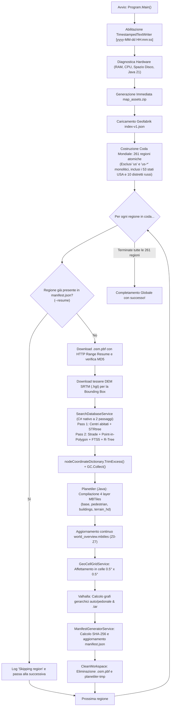

# 03 - Guida Operativa `build-world`: Funzionamento Passo-Passo e Mappatura Esaustiva dei File

Questo documento fornisce la **mappatura dettagliata e completa di ogni singolo file** del progetto `map-builder` e la spiegazione approfondita del comando:

```bash
dotnet run --project map-builder/src/NaRotta.MapBuilder.Cli -- build-world [--output <path>]
```

Viene descritto esattamente **cosa fa passo dopo passo**, **da dove preleva i dati sorgente**, **come li elabora e ottimizza in memoria** e **quali artefatti finali produce**.

---

## 0. Come Funziona MapBuilder "In Pratica": Il Flusso dei Dati da X ad A, B, C

Per comprendere intuitivamente cosa fa `MapBuilder`, immaginalo come una **fabbrica di trasformazione**:

```
[Sorgenti Grezze X]  ───>  [Tool di Scomposizione Y]  ───>  [Artefatti Finali A, B, C]
• OpenStreetMap PBF         • SearchDatabaseService (C#)     • _search.db (Ricerca FTS5/RTree)
• DEM Altimetria NASA       • Planetiler (Java)              • _tiles_*.mbtiles (Grafica Vettoriale)
• Catalogo Geofabrik        • GeoCellGridService (C#)        • cells/ (Celle 50x50km per selezione a dito)
                            • Valhalla (C# / C++)            • _routing_*.tar (Calcolo Percorsi)
                                                             • manifest.json (Indice con SHA-256)
```

---

### 1. Da dove scarica i dati (Le sorgenti X)
Un'app di navigazione non può usare direttamente una mappa grezza da internet: deve prima digerirla. MapBuilder scarica tre cose:
1. **L'indice mondiale (`index-v1.json`)**: scaricato da `https://download.geofabrik.de/index-v1.json`. Contiene l'elenco di tutte le 261 regioni/stati del mondo con i loro confini geografici.
2. **I dati cartografici grezzi (`.osm.pbf`)**: per ciascuno dei 261 stati (es. `albania`, `denmark`, `us/california`), scarica il file compresso `.osm.pbf` da Geofabrik. Questo file contiene miliardi di nodi GPS, linee e relazioni senza indici di ricerca e senza grafica pre-renderizzata.
3. **Le quote altimetriche (`.hgt.gz`)**: scarica le tessere DEM SRTM 1-arc-second (~30 metri di risoluzione) dai server pubblici NASA/ViewfinderPanoramas per conoscere l'altezza sul livello del mare di ogni metro di territorio.

---

### 2. Come scompone i dati e con che strumenti (I tool Y e i dati intermedi)
MapBuilder prende quel singolo file `.osm.pbf` scaricato (che da solo non è navigabile) e lo **scompone in 4 rami operativi distinti**:

#### Ramo 1: Il Motore di Ricerca Offline (`SearchDatabaseService` in C#)
- **Cosa fa**:
  1. *Passaggio 1*: Scansiona il PBF ed estrae tutti i comuni e le frazioni (`place=city|town|village`), mettendoli in un albero geometrico in memoria (`STRtree`).
  2. *Passaggio 2*: Scansiona tutte le strade e i POI (ristoranti, negozi, numeri civici). Poiché nella maggior parte di OpenStreetMap le vie non indicano il comune di appartenenza (`addr:city`), il nostro codice interroga l'albero geometrico e **calcola a quale comune appartiene ogni via**. Inoltre **fonde tutti i pezzetti della stessa via** (se "Via Roma" ha 20 segmenti spezzati, ne crea uno solo con il centroide).
- **Cosa genera (Output A)**:
  📁 `output/regions/<regione>/<regione>_search.db`  
  Un database SQLite ultra-compatto con due indici virtuali speciali:
  - **FTS5**: per cercare per nome parziale in 2 millisecondi (es. *"Via Rom..."* ➔ trova subito *"Via Roma"*).
  - **R-Tree**: indice spaziale per cercare *"i ristoranti o benzinai entro 3 km dal punto GPS in cui mi trovo"*.

#### Ramo 2: Il Motore Grafico dei Vector Tiles (`Planetiler` in Java)
- **Cosa fa**: Prende il PBF grezzo e lo trasforma in **tasselli vettoriali MVT** (piccoli riquadri geometrici compressi a vari livelli di zoom). Per non creare un unico file ingestibile e per permettere all'utente di scaricare solo ciò che gli serve, lo divide in **4 layer indipendenti** basati sui nostri schemi YAML in `profiles/`:
  - `_tiles_base.mbtiles` (Zoom 8–14): Rete stradale carrabile per auto/moto, fiumi, laghi, boschi e toponimi.
  - `_tiles_pedestrian.mbtiles` (Zoom 13–15): Marciapiedi, piste ciclabili, sentieri montani CAI e scalinate.
  - `_tiles_buildings.mbtiles` (Zoom 13–15): Impronte 3D degli edifici con altezza in metri per la vista prospettica.
  - `_tiles_terrain_hd.mbtiles` (Zoom 9–14): Vette montane con altitudine, passi alpini e curve di livello.
  Inoltre unisce le strade principali nel file globale `world_overview.mbtiles` (Zoom 0–7) che permette di zoomare indietro e vedere l'intero pianeta.
- **Cosa genera (Output B)**:
  📁 `output/regions/<regione>/<regione>_tiles_*.mbtiles`  
  File standard MBTiles (database SQLite di tasselli compressi gzip) pronti per essere disegnati a 60 FPS da MapLibre sul display dello smartphone.

#### Ramo 3: L'Affettatrice in Micro-Celle 50x50 km (`GeoCellGridService` in C#)
- **Cosa fa**: Prende i file `.mbtiles` della regione e li **ritaglia a griglia** in riquadri da 0.5° × 0.5° di latitudine e longitudine (circa 55 km × 55 km).
- **Cosa genera (Output C)**:
  📁 `output/cells/<coord>/cell_<lat>_<lon>_<layer>.mbtiles`  
  *A cosa serve questo all'utente?*  
  Se l'utente sull'app NaRotta non vuole scaricare l'intera Francia da 15 GB, ma vuole fare un weekend solo a Parigi o cerchia col dito un'area sulla mappa, **l'app scarica solo le 2 o 3 celle da 50x50 km che ha cerchiato** (pochi megabyte anziché 15 GB)! La stessa cosa per un itinerario: scarica solo la striscia di celle lungo l'autostrada.

#### Ramo 4: Il Motore di Routing e Calcolo Percorsi (`ValhallaRoutingService`)
- **Cosa fa**: Estrae la topologia delle strade (sensi unici, svolte vietate, rotonde, velocità massime) e combina i dati altimetrici DEM per sapere le pendenze in salita/discesa. Compila il grafo in due livelli (arterie veloci a lungo raggio + dettaglio urbano capillare).
- **Cosa genera (Output D)**:
  📁 `output/regions/<regione>/<regione>_routing_auto.tar` (per auto e moto)  
  📁 `output/regions/<regione>/<regione>_routing_pedestrian.tar` (per pedoni e bici)

---

### 3. Cosa fa alla fine di ogni regione
Non appena i 4 rami hanno finito per una regione:
1. **Elimina il PBF scaricato**: cancella immediatamente il file `.osm.pbf` da `workspace/pbf/` per liberare spazio su disco (così sul PC non si accumulano centinaia di GB di file temporanei).
2. **Certifica i file generati**: calcola il codice hash **SHA-256** e il peso esatto in byte di ciascun file prodotto (`.db`, `.mbtiles`, `.tar`, celle).
3. **Aggiorna il catalogo centrale (`manifest.json`)**: scrive queste informazioni in `output/manifest.json`.
4. **Passa alla regione successiva**: ripete il ciclo per la regione successiva della coda mondiale.

Quando l'utente aprirà l'app NaRotta sul telefono, l'app leggerà il `manifest.json` e saprà istantaneamente quali mappe sono disponibili, quanto pesano, e scaricherà solo i file scelti dall'utente.

---

## 1. Mappatura Esaustiva di Ogni File del Progetto

### 1.1 Profili di Rendering Planetiler (`map-builder/profiles/`)
Questi file definiscono le regole di conversione dalle feature grezze OpenStreetMap (tag OSM) ai layer dei vettori grafici MVT (Mapbox Vector Tiles):

| File | Scopo e Contenuto |
| :--- | :--- |
| **`overview-schema.yml`** | Configura i vettori a bassissimo zoom (**Z0 – Z7**): linee di costa, oceani, confini nazionali (`admin_level=2`), capitali, metropoli e grandi arterie di collegamento continentale (`motorway`, `trunk`). Viene usato per costruire `world_overview.mbtiles`. |
| **`driving-base-schema.yml`** | Configura la mappa stradale carrabile per la guida (**Z8 – Z14**): autostrade, strade statali, provinciali, urbane residenziali, sensi unici, rotonde, svincoli, fiumi, laghi, foreste, parchi e toponimi. |
| **`pedestrian-schema.yml`** | Configura la rete pedonale e ciclabile ad alto zoom (**Z13 – Z15**): marciapiedi (`footway`), piste ciclabili (`cycleway`), sentieri escursionistici montani (`path`, `track`), scalinate (`steps`) e aree pedonali urbane. |
| **`buildings-schema.yml`** | Configura le impronte volumetriche 3D degli edifici (**Z13 – Z15**): poligoni con attributi di altezza (`render_height`, `render_min_height`) e livelli per la vista 3D prospettica in navigazione. |
| **`terrain-schema.yml`** | Configura gli elementi morfologici montani (**Z9 – Z14**): vette montane (`natural=peak` con quota `ele`), passi e valichi alpini (`mountain_pass`), selle e idrografia d'alta quota. |

---

### 1.2 Codice Sorgente CLI C# .NET 10 (`map-builder/src/NaRotta.MapBuilder.Cli/`)

#### Root del Progetto
- **`NaRotta.MapBuilder.Cli.csproj`**: File di progetto per .NET 10 SDK (`net10.0`). Include le librerie ad alte prestazioni `OsmSharp` (parser stream PBF), `NetTopologySuite` (motore geometrico OGC e alberi spaziali), `Microsoft.Data.Sqlite` (motore SQLite per FTS5, R-Tree e MBTiles).
- **`Program.cs`**: Punto di ingresso (`Main`) e orchestratore dell'intera applicazione.
  - Inizializza il logger con timestamp su `Console.Out` e `Console.Error`.
  - Configura la gestione dell'annullamento pulito da tastiera (`Console.CancelKeyPress` / Ctrl+C).
  - Istanzia tutti i servizi applicativi tramite dependency injection manuale.
  - Smista i comandi CLI (`doctor`, `list`, `download`, `build-search`, `build-tiles`, `build-routing`, `build-overview`, `build-assets`, `build`, `batch-build`, `build-world`).
  - Nel comando `build-world`, costruisce la coda mondiale di 261 regioni atomiche escludendo i container monolitici ridondanti.

#### Modulo di Logging (`Logging/`)
- **`TimestampedTextWriter.cs`**: Decoratore thread-safe derivato da `TextWriter`. Intercetta tutto l'output generato dall'applicazione C# e dai processi figli (Planetiler, Valhalla), anteponendo a ogni riga non vuota il timestamp locale preciso al secondo: `[yyyy-MM-dd HH:mm:ss]`.

#### Modelli Dati (`Models/`)
- **`BuildOptionsModel.cs`**: Rappresenta e valida le opzioni da riga di comando (es. `--region`, `--output`, `--workspace`, `--resolutions`, `--slice-cells`, `--split-subregions`, `--resume`, `--clean-workspace`, `--no-elevation`).
- **`GeofabrikRegionModel.cs`**: Modello che descrive una voce del catalogo Geofabrik: ID (es. `us/california`), parent ID, nome descrittivo, codice ISO, URL PBF, URL MD5, poligono geometrico `NetTopologySuite.Geometries.Geometry` e bounding box. Implementa `GetFileSlug()` per sanificare i percorsi su file system.
- **`GeoCellModels.cs`**: Modelli per l'affettamento spaziale in micro-celle 0.5° × 0.5°:
  - `GeoCellCoordinateModel`: Rappresenta l'indice della cella (es. lat 45.0°, lon 11.0°).
  - `GeoCellBoundingBoxModel`: Bounding box minima/massima della cella.
  - `GeoCellManifestModel`: Voce nel manifest per i pacchetti della singola cella.
- **`HardwareProfileModel.cs`**: Raccoglie la diagnosi hardware: sistema operativo, RAM totale, RAM libera, spazio su disco, numero di thread logici, disponibilità di Java 21 e modalità di esecuzione Valhalla. Calcola la memoria JVM ideale (`-Xmx`) e la modalità Planetiler (`ram` vs `mmap`).
- **`ManifestModel.cs`**: Struttura serializzabile del file `manifest.json`. Contiene l'indice di tutte le regioni, i layer MBTiles disponibili, i pacchetti di routing, le celle geografiche, i codici hash SHA-256 e i pesi in byte.
- **`SearchEntityModels.cs`**: Modelli in-memory usati durante l'estrazione e l'indicizzazione:
  - `AdminPlaceModel`: Comune o frazione (`place=city|town|village|hamlet`) con bounding box espansa per l'indice spaziale `STRtree`.
  - `StreetRecordModel`: Via unificata e deduplicata (con toponimo, comune di appartenenza, CAP, centroide e conteggio segmenti).
  - `PoiRecordModel`: Punto di interesse (negozio, benzinaio, ristorante, farmacia) o numero civico.

#### Esecutori di Processi Esterni (`Runners/`)
- **`IProcessRunner.cs`**: Interfaccia contrattuale per lanciare processi esterni in modo asincrono con streaming dei log e token di cancellazione.
- **`CrossPlatformProcessRunner.cs`**: Implementazione multipiattaforma. Gestisce l'avvio di comandi su Windows nativo, Linux nativo, bridge WSL2 (`wsl -- ...`) e container Docker, convertendo automaticamente i path Windows (`C:\...`) nei rispettivi path Unix (`/mnt/c/...`).

#### Servizi Applicativi Core (`Services/`)
- **`GeofabrikCatalogService.cs`**: Scarica e mantiene in cache l'indice globale `index-v1.json` di Geofabrik. Risolve le gerarchie (continente ➔ nazione ➔ stato) e mappa correttamente i 53 stati atomici degli USA (`us/*`) e i 10 distretti federali della Russia.
- **`PbfDownloadService.cs`**: Gestisce il download HTTP resiliente dei file `.osm.pbf`. Supporta la ripresa da interruzione tramite header `Range`, visualizza la percentuale di avanzamento e valida l'integrità del file tramite verifica del checksum MD5 remoto.
- **`DemElevationService.cs`**: Calcola quali tasselli altimetrici 1° × 1° (SRTM HGT) intersecano la bounding box della regione e li scarica automaticamente da server pubblici, inserendoli nella cache riutilizzabile `workspace/elevation/`.
- **`SearchDatabaseService.cs`**: Motore in puro C# a **2 passaggi** con indice spaziale in-memory `STRtree`:
  - *Pass 1*: estrae i centri abitati e indicizza le coordinate dei nodi.
  - *Pass 2*: scansiona le strade e i POI, risolve il comune più vicino tramite ricerca geometrica nel raggio, fonde i tronconi della stessa via e popola il database SQLite con FTS5 (ricerca full-text) e R-Tree (ricerca spaziale per coordinate).
  - Esegue `TrimExcess()` e `GC.Collect()` forzato al termine per non occupare memoria RAM.
- **`PlanetilerTileService.cs`**: Scarica automaticamente `planetiler.jar` se assente, prepara i parametri JVM e lancia la compilazione dei layer vettoriali `.mbtiles`. Gestisce inoltre il merge continuo del layer globale `world_overview.mbtiles` e lo split senza bordi tagliati per le sotto-regioni.
- **`GeoCellGridService.cs`**: Motore di tassellatura geometrica in celle 0.5° × 0.5°. Apre il file `.mbtiles` regionale, filtra i tasselli che intersecano la cella e scrive il micro-archivio `.mbtiles` della cella in `output/cells/<coord>/`.
- **`ValhallaRoutingService.cs`**: Compila le tessere di routing gerarchiche Valhalla (stradali e pedonali) integrando le quote DEM per calcolare pendenze, curve di livello e velocità medie realistiche. Impacchetta i file in archivi `.tar`.
- **`OfflineAssetsService.cs`**: Crea il pacchetto `map_assets.zip` contenente gli stili grafici MapLibre giorno e notte (`style-day.json`, `style-night.json`), i glifi dei font in formato PBF e gli sprite vettoriali.
- **`HardwareProfilerService.cs`**: Rileva RAM libera, dischi, CPU thread e JVM disponibile, calibrando dinamicamente i flag di Planetiler per evitare saturazioni di memoria.
- **`ManifestGeneratorService.cs`**: Scansiona la cartella di output, calcola gli hash crittografici SHA-256 e le dimensioni in byte di tutti i file generati e produce l'indice unificato `manifest.json`.

---

### 1.3 Suite di Test Unitari (`map-builder/tests/NaRotta.MapBuilder.Tests/`)
La suite contiene 40 test unitari eseguiti con xUnit su .NET 10:

- **`BuildOptionsModelTests.cs`**: Verifica il corretto parsing di tutti i flag da riga di comando.
- **`CrossPlatformProcessRunnerTests.cs`**: Verifica la conversione dei percorsi tra Windows e WSL2/Linux.
- **`GeofabrikCatalogServiceTests.cs`**: Verifica la risoluzione gerarchica delle regioni, il recupero dei sotto-stati USA e la gestione dei cataloghi assenti.
- **`GeofabrikRegionModelTests.cs`**: Verifica la generazione corretta dello slug file (es. `us/california` ➔ `california`) e la stringa bounding box.
- **`GeoCellGridServiceTests.cs`**: Verifica gli algoritmi di calcolo delle coordinate di cella e la matematica di intersezione spaziale.
- **`HardwareProfileModelTests.cs`**: Verifica il calcolo del limite di heap `-Xmx` per la JVM in base alla memoria fisica disponibile.
- **`ManifestSerializationTests.cs`**: Verifica la corretta serializzazione e formattazione JSON del manifest delle mappe.
- **`OfflineAssetsServiceTests.cs`**: Verifica che il pacchetto ZIP degli asset contenga tutti i file di stile necessari.
- **`PlanetilerTileServiceTests.cs`**: Verifica i limiti di zoom e le specifiche dei layer (overview, base, pedestrian, buildings, terrain).
- **`SearchDatabaseServiceTests.cs`**: Verifica i filtri di classificazione delle strade indicizzabili e l'estrazione dei toponimi.

---

### 1.4 Cartelle di Esecuzione e Output (Allineamento Automatico allo Stesso Livello)

Quando si specifica una cartella `--output` (es. `\\192.168.8.53\Miscuglio\Narotta\data\output` o `D:\data\output`), **`MapBuilder` allinea automaticamente sia `workspace` sia `profiles` allo stesso livello della cartella `output`**, creando una struttura modulare, pulita e completamente autonoma:

```
<Percorso Base> (es. \\192.168.8.53\Miscuglio\Narotta\data\)
├── output/        # Artefatti definitivi (manifest, DB, MBTiles, routing, celle)
├── workspace/     # Spazio di lavoro temporaneo (download PBF, cache DEM, temp Planetiler)
└── profiles/      # Schemi di rendering YAML (overview, base, pedestrian, buildings, terrain)
```

- **`profiles/`**: Viene creata allo stesso livello di `output` e popolata automaticamente con i 5 schemi YAML copiati dal progetto se non già presenti.
- **`workspace/`**: Viene creata allo stesso livello di `output` per contenere i PBF e la cache DEM (pulita a ogni fine regione).
- **`output/`**: Contiene gli archivi finali, `manifest.json`, `world_overview.mbtiles` e le celle 0.5° × 0.5°.

*(Nota: è comunque possibile forzare percorsi differenti indicando esplicitamente `--workspace <path>` o `--profiles <path>` da riga di comando).*

---

## 2. A Cosa Serve il Comando `build-world` e Come Funziona Passo-Passo

### 2.1 A Cosa Serve Esattamente `build-world` (Scopo & Filosofia "One-Click")

Il comando `build-world` è il **motore di generazione globale automatizzato** di NaRotta. Il suo scopo fondamentale è:

> **Generare da zero, con un solo comando e senza passaggi intermedi manuali, l'intero archivio cartografico planetario pronto per essere distribuito all'applicazione mobile NaRotta.**

#### Chi lo usa e dove gira
- **Non gira sullo smartphone dell'utente**: l'app mobile scaricherà solo i pacchetti già pronti via internet o userà le mappe già archiviate offline.
- **Gira sul computer o server di build (la "fabbrica delle mappe")**: è lo strumento che l'amministratore lancia periodicamente (es. ogni mese o a ogni aggiornamento di OpenStreetMap) per aggiornare tutti i dati mondiali.

#### Perché è necessario: cosa offre all'utente dell'app NaRotta
Affinché un utente in qualsiasi parte del mondo possa aprire l'app NaRotta e decidere liberamente cosa scaricare:
1. **Un intero stato o regione** (es. *Toscana*, *Baviera*, *California*);
2. **Un'area libera cerchiata con il dito sullo schermo** (selezione a lazo per non sprecare memoria e scaricare solo pochi megabyte);
3. **Il corridoio stretto attorno a un itinerario stradale** (es. solo 1 km a destra e a sinistra dell'autostrada da Milano a Parigi);
4. **La navigazione globale a basso zoom** (vedere tutto il pianeta da lontano senza buchi neri);
5. **La ricerca indirizzi e POI 100% offline** e il **calcolo del percorso senza internet**;

...tutti questi file devono essere stati preventivamente calcolati, ottimizzati, affettati e indicizzati nel catalogo `manifest.json`. **`build-world` è il comando che produce tutto questo per l'intero pianeta**.

#### Cosa automatizza rispetto ai comandi singoli
Senza `build-world`, l'operatore dovrebbe:
- Lanciare manualmente `build-assets` per compilare font, icone e stili giorno/notte.
- Lanciare manualmente `build-overview` per la mappa globale a basso zoom.
- Lanciare manualmente `build --region <id>` per 261 volte consecutive, ricordandosi ogni volta di specificare i flag corretti (`--split-subregions`, `--slice-cells`, `--clean-workspace`, `--resume`).
- Gestire a mano il rischio di saturazione della RAM e del disco (es. non scaricare l'archivio monolitico da 12 GB degli USA interi, ma dividerlo per stati).

Con `build-world`, basta digitare un solo comando:

```bash
dotnet run --project map-builder/src/NaRotta.MapBuilder.Cli -- build-world [--output <path>]
```

Il comando attiva in automatico tutte le impostazioni ottimali:
- **`--split-subregions`**: estrae le sotto-regioni senza tagliare strade e poligoni sui confini.
- **`--slice-cells`**: crea i quadratini 0.5° × 0.5° (~50x50 km) per la selezione a lazo o lungo la rotta.
- **`--resume`**: se il computer viene spento o la rete cade, riparte istantaneamente saltando le regioni già finite.
- **`--clean-workspace`**: cancella i file grezzi PBF pesanti non appena una regione è finita, evitando di saturare il disco.
- **Scomposizione atomica**: divide gli USA nei 53 singoli stati e la Russia nei suoi distretti federali, garantendo stabilità di memoria e modularità per gli utenti mobili.

---

### 2.2 Differenze Chiave tra `build-world` e `batch-build`

Sebbene entrambi i comandi elaborino una lista di regioni in sequenza (batch), rispondono a due scopi operativi completamente diversi:

| Caratteristica | `build-world` | `batch-build` |
| :--- | :--- | :--- |
| **Ambito Geografico** | **Tutto il pianeta Terra (Mondo intero)** | **Una singola nazione o macro-regione** specificata con `--region <id>` |
| **Parametro `--region`** | **Non richiesto / Ignorato** (attraversa in automatico tutti i 7 continenti, 261 stati/regioni) | **Obbligatorio** (es. `--region italy`, `--region us`, `--region france`, `--region europe`) |
| **Preset e Flag Attivi** | **All-in-One Zero-Config**: attiva automaticamente tutti i 5 layer, `--split-subregions`, `--slice-cells`, `--clean-workspace`, `--resume` | **Flessibile e Modulare**: l'operatore decide quali layer generare e quali opzioni attivare |
| **Layer Vettoriali** | Tutti e 5 i layer (`Overview`, `Base`, `Pedestrian`, `Buildings`, `Terrain`) | Solo i layer specificati da `--resolutions` (default: `Base`, `Pedestrian`, `Buildings`, `Terrain`) |
| **Affettamento Celle 50x50 km** | Attivo di default (`--slice-cells=true`) | Opzionale (richiede il flag `--slice-cells`) |
| **Sotto-regioni senza taglio** | Attivo di default (`--split-subregions=true`) | Opzionale (richiede il flag `--split-subregions`) |
| **Pulizia automatica PBF** | Attiva di default (`--clean-workspace=true`) per non saturare il disco | Opzionale (richiede il flag `--clean-workspace`) |
| **Ripresa automatica** | Attiva di default (`--resume=true`), salta le regioni già nel manifest | Opzionale (richiede il flag `--resume`) |
| **Target di utilizzo principale** | **Produzione e rilascio periodico**: per preparare l'intero server di download per gli utenti mondiali di NaRotta | **Sviluppo, test e aggiornamenti locali**: per rigenerare rapidamente solo un paese o testare un layer |

#### Esempi Pratici di Utilizzo a Confronto:

1. **Voglio generare l'intero catalogo mondiale per l'app NaRotta**:
   ```bash
   dotnet run --project map-builder/src/NaRotta.MapBuilder.Cli -- build-world --output "\\192.168.8.53\Miscuglio\Narotta\data\output"
   ```
   *(Nessun altro parametro necessario: compila tutte le 261 regioni mondiali con tutti i layer e le celle).*

2. **Voglio aggiornare soltanto le 20 regioni d'Italia dopo un aggiornamento stradale locale**:
   ```bash
   dotnet run --project map-builder/src/NaRotta.MapBuilder.Cli -- batch-build --region italy --slice-cells --split-subregions --clean-workspace --resume --output "\\192.168.8.53\Miscuglio\Narotta\data\output"
   ```
   *(Elabora a cascata solo l'Italia e le sue 20 regioni: Lombardia, Veneto, Lazio, Sicilia, ecc., senza toccare il resto del mondo).*

3. **Voglio aggiornare soltanto i 53 stati degli USA**:
   ```bash
   dotnet run --project map-builder/src/NaRotta.MapBuilder.Cli -- batch-build --region us --slice-cells --clean-workspace --resume --output "\\192.168.8.53\Miscuglio\Narotta\data\output"
   ```
   *(Elabora a cascata solo i 53 stati USA: California, Texas, New York, Florida, ecc.).*

4. **Voglio testare al volo durante lo sviluppo solo la grafica carrabile (`base`) delle regioni francesi senza routing né celle**:
   ```bash
   dotnet run --project map-builder/src/NaRotta.MapBuilder.Cli -- batch-build --region france --resolutions base --skip-routing
   ```

---

### 2.3 Flusso Logico Globale (Mermaid Diagram)



---

### Passo 0: Inizializzazione e Creazione degli Asset Condivisi
1. **Attivazione Logging Unificato**: Viene installato `TimestampedTextWriter` che formatta ogni output con data e ora esatta (`[2026-10-19 09:47:05]`).
2. **Diagnostica Hardware**: `HardwareProfilerService` ispeziona il sistema (64 GB RAM, 32 thread CPU, disponibilità di Java 21 LTS). Calcola la dimensione ideale della memoria per Planetiler (`-Xmx41g`) e seleziona la modalità `nodemap=array, storage=ram` per la massima velocità.
3. **Pacchetto Asset Offline**: Viene creato immediatamente l'archivio `output/assets/map_assets.zip` contenente gli stili MapLibre, gli sprite e i font PBF, pronto per l'applicazione mobile.
4. **Costruzione della Coda Mondiale**:
   - `GeofabrikCatalogService` scarica l'indice ufficiale.
   - Vengono esplorati tutti i continenti: `europe`, `north-america`, `south-america`, `asia`, `africa`, `australia-oceania`, `central-america`, `russia` e `antarctica`.
   - **Ottimizzazione Fondamentale**: L'archivio monolitico `us` (11.6 GB) e i raggruppamenti macro `us-*` vengono rimossi dalla coda; vengono accodati direttamente i **53 singoli stati americani** (`us/alabama`, `us/california`, ecc.) e i 10 distretti federali russi.
   - Totale regioni in coda: **261 regioni atomiche**.

---

### Passo 1: Controllo di Ripresa (`--resume`)
Per ciascuna delle 261 regioni:
1. `ManifestGeneratorService` verifica se la regione è già presente e completa in `manifest.json`.
2. Se presente, la regione viene saltata in **0.01 secondi** stampando a video:
   ```
   [Batch X/261] Skipping '<region>' (already present in manifest.json).
   ```
3. Se non presente, inizia l'elaborazione.

---

### Passo 2: Acquisizione dei Dati Sorgente (Da dove prende i dati)
1. **Dati Geografici OpenStreetMap (`.osm.pbf`)**:
   - Vengono scaricati direttamente dai server ufficiali Geofabrik (es. `https://download.geofabrik.de/europe/albania-latest.osm.pbf`).
   - Il servizio supporta la **ripresa automatica** in caso di disconnessione (HTTP header `Range: bytes=...`).
   - Viene scaricato il file `.md5` corrispondente e verificato l'hash crittografico del file scaricato prima di procedere.
2. **Dati Altimetrici Altimetria DEM (`.hgt`)**:
   - `DemElevationService` calcola i gradi interi di latitudine e longitudine coperti dalla regione.
   - Scarica le tessere SRTM 1-arc-second (~30 metri di risoluzione) dai server pubblici NASA/ViewfinderPanoramas.
   - Le salva in `workspace/elevation/` dove rimangono in cache per tutte le regioni limitrofe.

---

### Passo 3: Elaborazione Ricerca Offline in C# (`SearchDatabaseService`)
Il file `.osm.pbf` viene scansionato direttamente in C# senza passare per database intermedi pesanti come PostgreSQL:
1. **Passaggio 1 (Centri Abitati e Nodi)**:
   - Scansiona tutti i nodi e le relazioni con `place=*` (`city`, `town`, `village`, `hamlet`, `suburb`).
   - Memorizza i comuni in un albero geometrico **`STRtree<AdminPlaceModel>`** in RAM (NetTopologySuite).
2. **Passaggio 2 (Strade, Numeri Civici e POI)**:
   - Scansiona le `way` con tag `highway` e `name` (strade denominate) e gli elementi con `addr:housenumber` o `amenity`/`shop`/`tourism` (POI).
   - **Risoluzione Comune (Point-in-Polygon)**: Poiché nella maggior parte dei dati OSM le strade non hanno il tag `addr:city`, il servizio interroga l'`STRtree` spaziale e associa automaticamente la via al comune più vicino.
   - **Deduplicazione Stradale**: Tutti i segmenti appartenenti alla stessa via nello stesso comune vengono aggregati in un record unico con centroide medio.
3. **Scrittura ad Altissima Velocità su SQLite**:
   - Crea un database SQLite temporaneo con `PRAGMA synchronous = OFF` e `PRAGMA journal_mode = MEMORY`.
   - Popola le tabelle relazionali `places`, `streets`, `pois`.
   - Popola l'indice full-text **FTS5** (`search_fts`) con supporto per tokenizzazione e prefissi parziali.
   - Popola l'indice spaziale **R-Tree** (`streets_rtree`, `pois_rtree`) per ricerche geografiche nel raggio visibile.
4. **Rilascio Immediato della Memoria**:
   - `nodeCoordinateDictionary.Clear();`
   - `nodeCoordinateDictionary.TrimExcess();`
   - `GC.Collect(2, GCCollectionMode.Forced, true);`
   - La RAM viene restituita istantaneamente al sistema operativo.

---

### Passo 4: Rendering Vettoriale Multi-Risoluzione con Planetiler (`PlanetilerTileService`)
Planetiler (eseguito su JVM 21) legge il file `.osm.pbf` e compila i layer secondo i profili YAML:
1. **Layer Overview (Z0–Z7)**: Viene fuso atomicamente in `output/overview/world_overview.mbtiles` per garantire la navigazione fluida a basso zoom su tutto il globo.
2. **Layer Base Driving (Z8–Z14)**: Rete stradale carrabile completa di svincoli, corsie e sensi unici.
3. **Layer Pedestrian (Z13–Z15)**: Sentieri, ciclabili, marciapiedi e gradini.
4. **Layer Buildings 3D (Z13–Z15)**: Impronte ed altezze degli edifici.
5. **Layer Terrain HD (Z9–Z14)**: Vette alpine, quote e passi montani.

---

### Passo 5: Slicing in Geo-Celle 0.5° × 0.5° (`GeoCellGridService`)
Per permettere all'utente mobile di selezionare col dito un'area (selezione a lazo) o di scaricare la mappa dettagliata solo lungo una rotta:
1. Il servizio apre il file `.mbtiles` appena compilato.
2. Identifica tutte le celle geografiche da mezzo grado per mezzo grado (circa 55 km × 55 km all'equatore) che cadono all'interno della regione.
3. Estrae i tasselli vettoriali corrispondenti e scrive il micro-archivio `.mbtiles` nella cartella `output/cells/<lat_lon>/`.

---

### Passo 6: Grafo di Routing Multimodale con Valhalla (`ValhallaRoutingService`)
1. Viene compilato il grafo gerarchico multimodale Valhalla a due livelli:
   - **Livello 0 / Arteriale**: Autostrade e grandi strade a scorrimento per il calcolo di rotte a lunghissimo raggio.
   - **Livello 1 / Locale**: Rete capillare urbana, sensi unici, svolte vietate e percorsi pedonali.
2. Vengono integrate le pendenze calcolate dalle tessere altimetriche DEM.
3. Il grafo viene impacchettato nei due archivi compressi:
   - `<slug>_routing_auto.tar`
   - `<slug>_routing_pedestrian.tar`

---

### Passo 7: Certificazione Crittografica e Aggiornamento Manifest (`ManifestGeneratorService`)
1. Vengono calcolati i codici crittografici **SHA-256** e le dimensioni esatte in byte di tutti gli artefatti prodotti per la regione.
2. Viene aggiornato in modo atomico il file `output/manifest.json`. In questo modo l'applicazione mobile sa con precisione se un file è aggiornato, quanto spazio occuperà e ne convalida l'integrità dopo il download.

---

### Passo 8: Pulizia del Workspace Locale (`--clean-workspace`)
Per evitare qualsiasi accumulo di dati su disco:
1. Il file `.osm.pbf` (che pesa centinaia di megabyte o gigabyte) viene eliminato da `workspace/pbf/`.
2. La directory temporanea dei chunk di Planetiler (`workspace/planetiler-tmp/`) viene ripulita da qualsiasi file temporaneo residuo.
3. Sul disco locale `C:` rimane occupato solo lo spazio strettamente necessario per le tessere DEM riutilizzabili, mentre **tutto l'output definitivo risiede in sicurezza sulla share di rete (con 3,2 TB di spazio)**.
4. La pipeline passa alla regione successiva della coda e ripete il ciclo fino al completamento di tutte le 261 regioni mondiali.

---

## 4. Guida di Riferimento Dettagliata per Ciascun File di Output

Questa sezione spiega in dettaglio l'esatto scopo, formato, contenuto e momento di utilizzo di ogni singolo file generato all'interno della cartella `output/`.

```
output/
├── manifest.json                                      # Catalogo globale con hash SHA-256 e metadati
├── assets/
│   └── map_assets.zip                                 # Stili MapLibre (giorno/notte), icone, sprite e font glifi
├── overview/
│   └── world_overview.mbtiles                         # Mappa globale a basso zoom (Z0–Z7) per l'intero pianeta
├── cells/
│   └── <cell_id>/                                     # Micro-celle geografiche modulari da 0.5° × 0.5° (~55 × 55 km)
│       ├── <cell_id>_tiles_base.mbtiles               # Rete stradale locale per la cella
│       ├── <cell_id>_tiles_pedestrian.mbtiles         # Sentieri e marciapiedi per la cella
│       ├── <cell_id>_tiles_buildings.mbtiles          # Sagome 3D degli edifici per la cella
│       └── <cell_id>_tiles_terrain_hd.mbtiles         # Curve di livello e vette per la cella
└── regions/
    └── <regione>/                                     # Pacchetti completi a livello di nazione o stato federale
        ├── <regione>_search.db                        # Database SQLite con FTS5 (ricerca testo) e R-Tree (spaziale)
        ├── <regione>_tiles_base.mbtiles               # Mappa stradale e carrabile completa (Z8–Z14)
        ├── <regione>_tiles_pedestrian.mbtiles         # Rete pedonale, sentieri e ciclabili (Z13–Z15)
        ├── <regione>_tiles_buildings.mbtiles          # Volumetrie ed estrusioni 3D degli edifici (Z13–Z15)
        ├── <regione>_tiles_terrain_hd.mbtiles         # Dati topografici, vette e valichi montani (Z9–Z14)
        ├── <regione>_routing_auto.tar                 # Grafo gerarchico Valhalla per navigazione auto e moto
        └── <regione>_routing_pedestrian.tar           # Grafo gerarchico Valhalla per navigazione pedonale e trekking
```

---

### 1. `assets/map_assets.zip`
* **Formato**: Archivio compresso ZIP standard.
* **Cosa contiene**:
  * I file di stile JSON per MapLibre (`style-day.json`, `style-night.json`, `style-satellite-overlay.json`).
  * Gli sprite grafici (icone vettoriali in formato PNG + JSON per POI, distributori, ospedali, hotel, ristoranti, segnali stradali, a risoluzione 1x e 2x Retina).
  * I glifi dei caratteri PBF (font vettoriali suddivisi in range Unicode per renderizzare etichette in tutte le lingue senza connessione internet).
* **A cosa serve all'app**: È il "motore grafico" dell'interfaccia cartografica. Senza questo pacchetto, la mappa vettoriale non saprebbe quali colori usare per strade, foreste e fiumi, né come disegnare i nomi dei luoghi e le icone.
* **Quando viene scaricato**: Una sola volta, al primo avvio dell'app (pesa circa **5 – 8 MB**), e viene aggiornato solo se cambia la versione dello stile grafico.

---

### 2. `cells/<cell_id>/<cell_id>_tiles_*.mbtiles`
* **Formato**: Micro-database SQLite contenenti tessere vettoriali compresse (MBTiles standard).
* **Convenzione Naming `<cell_id>`**: Coordinate geografiche deterministiche a passi di 0.5 gradi (es. `N45_50_E010_50` rappresenta il rettangolo tra 45.5°N–46.0°N e 10.5°E–11.0°E, circa 55 × 55 km).
* **Cosa contiene**:
  * `<cell_id>_tiles_base.mbtiles`: Strade, autostrade e toponimi della singola cella (Z8–Z14).
  * `<cell_id>_tiles_pedestrian.mbtiles`: Sentieri, piste ciclabili e marciapiedi della cella (Z13–Z15).
  * `<cell_id>_tiles_buildings.mbtiles`: Edifici 2D/3D presenti nel perimetro della cella (Z13–Z15).
  * `<cell_id>_tiles_terrain_hd.mbtiles`: Rilievi e vette montane della cella (Z9–Z14).
* **A cosa serve all'app (Download Chirurgico a Basso Consumo Dati)**:
  * **Selezione a dito (Lasso Tool)**: Se l'utente disegna col dito un cerchio sulla mappa per scaricare solo la zona del lago di Garda o i dintorni di una città, l'app scarica esclusivamente le 3 o 4 micro-celle interessate (**pochi megabyte anziché scaricare l'intera Italia da 6 GB**).
  * **Corridoio di Itinerario (Route Corridor)**: Se l'utente pianifica un viaggio da Milano a Monaco di Baviera, l'app scarica solo la "striscia" di celle attraversate dall'autostrada, permettendo la navigazione offline dell'intero viaggio con un consumo dati minimo.

---

### 3. `overview/world_overview.mbtiles`
* **Formato**: Database SQLite MBTiles a copertura planetaria.
* **Cosa contiene**: Dati vettoriali ottimizzati per i bassi livelli di zoom (**Z0 – Z7**):
  * Linee di costa continentali, oceani, mari e grandi laghi.
  * Confini degli stati nazionali e delle macro-regioni.
  * Autostrade e grandi arterie di collegamento internazionali.
  * Capitali e grandi metropoli mondiali.
* **A cosa serve all'app**: Garantisce che l'utente non veda mai uno "sfondo vuoto" quando allontana la visuale (*zoom out*). Quando si guarda il globo o un intero continente, l'app legge questo file unico senza dover caricare i dettagli pesanti delle singole regioni locali.
* **Quando viene scaricato**: Pre-incluso nell'app o scaricato al primo setup (pesa circa **30 – 50 MB** per l'intero pianeta).

---

### 4. `regions/<regione>/<regione>_search.db`
* **Formato**: Database SQLite con estensioni native compilate **FTS5** (Full-Text Search) e **R-Tree** (Spatial Indexing).
* **Cosa contiene**:
  * Tabella `places`: Tutte le città, paesi, comuni, frazioni e quartieri della regione, con popolazione e gerarchia amministrativa.
  * Tabella `streets`: Tutte le vie, piazze e corsi deduplicati, collegati spazialmente al comune di appartenenza.
  * Tabella `pois`: Tutti i punti di interesse (ristoranti, farmacie, hotel, negozi, distributori, parcheggi, musei) con orari, numeri civici, recapiti telefonici e siti web.
  * Indice `search_fts`: Indice invertito FTS5 per la ricerca predittiva e l'autocompletamento istantaneo mentre l'utente digita caratteri nella barra di ricerca.
  * Indice `poi_rtree`: Indice spaziale geometrico 2D per trovare istantaneamente tutti i punti di interesse attorno alla posizione GPS attuale dell'utente (entro un raggio di 500m, 2km, 5km) senza rallentare il dispositivo.
* **A cosa serve all'app**: Permette all'utente di cercare indirizzi, città e punti d'interesse completamente offline (ad esempio in aereo, in montagna o all'estero senza roaming).

---

### 5. `regions/<regione>/<regione>_tiles_*.mbtiles` (I 4 Layer Vettoriali)
* **Formato**: Database SQLite MBTiles secondo la specifica standard Mapbox/OpenMapTiles.
* **Cosa contengono**:
  * **`<regione>_tiles_base.mbtiles` (Z8 – Z14)**:
    Rete stradale completa (autostrade, strade statali, provinciali, urbane), sensi unici, toponomastica delle città, corsi d'acqua principali, ferrovie, parchi e aree residenziali. È la mappa base per la visualizzazione generale e la guida in auto.
  * **`<regione>_tiles_pedestrian.mbtiles` (Z13 – Z15)**:
    Dettaglio ad alto zoom per chi si sposta a piedi o in bicicletta: marciapiedi, attraversamenti pedonali, scalinate, sentieri CAI, piste ciclabili, fontanelle d'acqua potabile e panchine.
  * **`<regione>_tiles_buildings.mbtiles` (Z13 – Z15)**:
    Impronte degli edifici con altezza in metri o numero di piani (`render_height`, `render_min_height`) e landmark famosi (torri, cattedrali, stadi) per il rendering tridimensionale estruso in prospettiva.
  * **`<regione>_tiles_terrain_hd.mbtiles` (Z9 – Z14)**:
    Dati topografici per amanti della montagna: vette, altitudini, passi montani, forcelle, rifugi alpini e curve di livello.
* **A cosa servono all'app**: Consentono il rendering vettoriale a 60 fotogrammi al secondo tramite la GPU dello smartphone. Essendo divisi in layer separati, l'utente può scegliere di scaricare solo la mappa base per risparmiare memoria, oppure aggiungere gli edifici 3D o i sentieri da trekking se necessario.

---

### 6. `regions/<regione>/<regione>_routing_*.tar`
* **Formato**: Archivio TAR compresso contenente l'albero di tessere binarie di routing `.gph` (Valhalla Graph Format).
* **Cosa contengono**:
  * **`<regione>_routing_auto.tar`**:
    Grafo delle strade carrabili con limiti di velocità, corsie, sensi unici, restrizioni di svolta, rotonde e tempi di percorrenza previsti per autovetture, furgoni e motocicli.
  * **`<regione>_routing_pedestrian.tar`**:
    Grafo pedonale e ciclabile ad alta risoluzione con sentieri, scalinate, pendenze (salite/discese calcolate dai rilievi DEM), ponti pedonali e aree pedonali vietate ai veicoli.
* **A cosa servono all'app**: Consentono al motore di navigazione offline dell'app di calcolare percorsi istantanei punto a punto (turn-by-turn navigation) con indicazioni vocali, ricalcolo immediato in caso di errore di rotta e profilo altimetrico del tragitto, anche in galleria o in assenza totale di copertura di rete cellulare.

---

### 7. `manifest.json`
* **Formato**: Documento JSON conforme alla specifica *NaRotta Unified Catalog Schema v2.2*.
* **Cosa contiene**:
  * Metadati globali: versione schema, data e ora esatta di generazione UTC, URL base del server/CDN.
  * Puntatore all'archivio `map_assets.zip` con relativa versione e codice hash crittografico SHA-256.
  * Puntatore al file `world_overview.mbtiles` con dimensioni in byte e hash SHA-256.
  * Array `regions`: Elenco completo di tutte le 261 regioni del mondo con:
    * ID univoco (`europe/italy`, `north-america/us/california`, ecc.)
    * Codice nazione ISO (`IT`, `FR`, `DE`, ecc.)
    * Bounding box geografico esatto `[minLon, minLat, maxLon, maxLat]`
    * Lista degli ID di tutte le micro-celle 0.5° che intersecano la regione
    * Dettaglio dei file di ricerca, layer vettoriali e routing con dimensione esatta in byte e impronta SHA-256
  * Array `cells`: Elenco indicizzato di tutte le decine di migliaia di micro-celle 0.5° × 0.5° con i rispettivi file vettoriali e hash SHA-256.
* **A cosa serve all'app**: È l'**indice centrale di verità**. All'avvio, l'app scarica solo questo piccolo file JSON:
  1. Mostra all'utente la lista degli stati disponibili al download con la dimensione esatta in Megabyte prima che prema "Scarica".
  2. Sa quali aggiornamenti sono disponibili confrontando gli hash SHA-256 con quelli salvati in locale sullo smartphone.
  3. Verifica l'integrità dei file scaricati calcolando l'hash SHA-256 sul dispositivo, proteggendo l'utente da download corrotti o interrotti prima di renderli attivi nella mappa.

