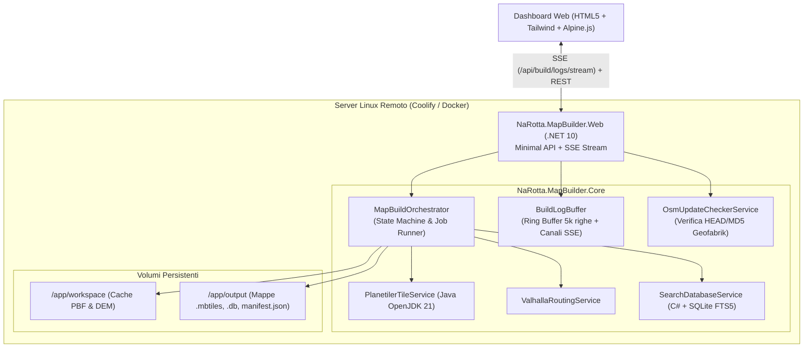

# 04 - Web Dashboard & Deployment Remoto su Coolify (`NaRotta.MapBuilder.Web`)

Questo documento descrive l'architettura, le API REST/SSE, l'interfaccia utente web e la procedura di distribuzione remota tramite **Coolify** su server Linux per l'applicazione **`NaRotta.MapBuilder.Web`**.

---

## 1. Obiettivi e Architettura del Sistema

L'applicazione web consente di:
1. **Monitorare in tempo reale** l'avanzamento del parsing e della generazione delle mappe offline (.mbtiles, SQLite FTS5, Valhalla .gph/.tar) senza dover accedere alla shell del server.
2. **Rilevare automaticamente aggiornamenti da OpenStreetMap (Geofabrik)**, confrontando data di rilascio, dimensione e MD5 del PBF remoto rispetto ai file già compilati localmente nel catalogo `manifest.json`.
3. **Gestire Start e Stop (Cancel)** del processo di build da qualsiasi browser (desktop o mobile), con arresto sicuro e pulizia delle risorse.
4. **Eseguire su Coolify**: deployment self-contained tramite Dockerfile multi-stage con runtime .NET 10, Java OpenJDK 21 (per Planetiler) e storage persistente.



---

## 2. API Endpoints e Server-Sent Events (SSE)

L'applicazione espone endpoint REST veloci e uno stream SSE dedicato per non bloccare il client ed evitare continui polling:

| Metodo | Endpoint | Descrizione |
| :--- | :--- | :--- |
| `GET` | `/api/status` | Restituisce lo stato corrente della build, la telemetria della macchina (CPU, RAM, disco libero) e la configurazione dei path. |
| `POST` | `/api/build/start` | Avvia un job di build in background. Accetta configurazione completa (regione, layer, subregions, geo-cells, resume, clean workspace). |
| `POST` | `/api/build/stop` | Invia il segnale di cancellazione sicura al `CancellationTokenSource` della pipeline attiva. |
| `GET` | `/api/build/logs` | Restituisce le ultime $N$ righe di log in formato JSON. |
| `GET` | `/api/build/logs/stream` | Stream continuo **Server-Sent Events (`text/event-stream`)**: invia eventi `log` per ogni nuova riga ed eventi `progress` al secondo. |
| `GET` | `/api/osm/updates` | Verifica upstream su Geofabrik se sono presenti aggiornamenti rispetto alle mappe locali. |
| `GET` | `/api/regions` | Restituisce l'alberatura delle regioni Geofabrik filtrabile con query testuale. |
| `GET` | `/api/manifest` | Restituisce il file `manifest.json` attuale con l'elenco dei pacchetti compilati. |
| `GET` | `/api/system/doctor` | Esegue la profilazione hardware e verifica la presenza di Java e Valhalla. |

---

## 3. Gestione e Configurazione dei Percorsi (`Workspace` e `Output`)

La pipeline richiede due cartelle distinte con scopi e requisiti di storage differenti:

### 3.1 Directory File Temporanei (`WorkspaceDirectory`)
- **Scopo**: cartella di lavoro ad alto throughput I/O per:
  - Cache dei dump OpenStreetMap grezzi scaricati da Geofabrik (`workspace/pbf/*.osm.pbf`).
  - Tasselli altimetrici DEM NASA/SRTM (`workspace/elevation/*.hgt`).
  - Database temporaneo SQLite/mmap di Planetiler (`workspace/planetiler-tmp/feature.db`).
  - File intermedi di espansione dei grafi Valhalla (`workspace/valhalla/valhalla_tiles`).
- **Valore di default**: `C:\narotta-workspace` (Windows) o `/app/workspace` (Linux/Docker).
- **Pulizia**: se si abilita il flag `--clean-workspace` (o dal pulsante nella Web UI), i file PBF e i database temporanei vengono rimossi al termine della compilazione per risparmiare spazio su disco.

### 3.2 Directory Output Finale (`OutputDirectory`)
- **Scopo**: archivio permanente e persistente contenente solo i manufatti finali destinati ai dispositivi client Walked/NaRotta:
  - Vector Tiles multi-risoluzione (`<region>_tiles_base.mbtiles`, `pedestrian.mbtiles`, `buildings.mbtiles`, `terrain_hd.mbtiles`, `world_overview.mbtiles`).
  - Database di ricerca offline SQLite FTS5 & R-Tree (`<region>_search.db`).
  - Grafi gerarchici compressi per navigazione turn-by-turn (`<region>_routing.tar`).
  - Catalogo indice firmato SHA-256 (`manifest.json`).
- **Valore di default**: `\\192.168.8.53\Miscuglio\Narotta\data\output` (share di rete Windows) o `/app/output` (Linux/Docker).

### 3.3 Modalità di Configurazione
I percorsi possono essere configurati e modificati attraverso 4 livelli di priorità:
1. **Dashboard Web (Tab "Percorsi & Storage")**: modificabili direttamente dal browser e salvabili sia a caldo in memoria sia nel file `appsettings.json`.
2. **Modale di Avvio Build**: consente di indicare percorsi personalizzati (`CustomWorkspaceDirectory` e `CustomOutputDirectory`) per una specifica esecuzione.
3. **Variabili d'Ambiente** (consigliato su Docker/Coolify): `WORKSPACE_DIR` e `OUTPUT_DIR`.
4. **File `appsettings.json`**: sezione `"MapBuilder": { "WorkspaceDirectory": "...", "OutputDirectory": "..." }`.

---

## 4. Rilevamento Aggiornamenti OpenStreetMap (`OsmUpdateCheckerService`)

Il servizio confronta i metadati remoti Geofabrik con i pacchetti registrati in `manifest.json`:
1. Viene eseguita una richiesta HTTP `HEAD` verso l'URL PBF ufficiale della regione (es. `https://download.geofabrik.de/europe/italy-latest.osm.pbf`).
2. Vengono estratti gli header `Last-Modified` e `Content-Length`.
3. Viene confrontata la data con il campo `lastModifiedUtc` dei pacchetti registrati localmente nel `manifest.json`:
   - **`UpToDate`**: Il pacchetto locale è allineato all'ultimo dump Geofabrik (differenza inferiore a 6 ore).
   - **`UpdateAvailable`**: Geofabrik ha pubblicato un dump più recente rispetto alla data di build locale.
   - **`NotBuiltYet`**: La regione non è ancora mai stata compilata.

Dalla dashboard è possibile fare clic su **"Compila"** direttamente dalla riga dell'aggiornamento per lanciare la pipeline per quella specifica regione.

---

## 4. Distribuzione su Coolify

### 4.1 Prerequisiti su Coolify
- Un server VPS Linux (es. Hetzner, OVH, DigitalOcean, Contabo) con Coolify installato.
- Almeno 8–16 GB di RAM (consigliati 32 GB se si compilano interi continenti o nazioni estese come Francia o Germania).
- Docker e Docker Compose abilitati (gestiti in automatico da Coolify).

### 4.2 Configurazione su Coolify (Passo-Passo)
1. In Coolify, crea un nuovo **Service** o **Application** selezionando **"Git Repository"** (oppure **"Docker Compose"**).
2. Seleziona il repository Git di `narotta` e specifica la cartella base `map-builder/`.
3. In **Build Pack**, seleziona **Dockerfile**. Coolify rileverà automaticamente `map-builder/Dockerfile`.
4. In **Ports Mappings**, inserisci:
   ```text
   8080:8080
   ```
5. In **Persistent Storage / Volumes**, configura i volumi persistenti:
   - Volume temporaneo: `/app/workspace` (directory temporanea di lavoro e cache PBF).
   - Volume condiviso host: `/var/data/shared-storage` montato su `/app/output` (cartella condivisa tra Map Builder e Map API dove risiedono i `.mbtiles`, `.db`, `.tar` e `manifest.json`). I file `docker-compose.yml` usano `${SHARED_STORAGE_PATH:-/var/data/shared-storage}:/app/output`, consentendo in locale l'uso di un file `.env` per mappare una cartella su Windows (es. `./data/output`).
6. In **Environment Variables**, imposta:
   ```env
   PORT=8080
   ASPNETCORE_ENVIRONMENT=Production
   WORKSPACE_DIR=/app/workspace
   OUTPUT_DIR=/app/output
   PROFILES_DIR=/app/profiles
   TOOLS_DIR=/app/tools
   BASE_URL=https://storage.narotta.app/maps/
   ```
7. Fai clic su **"Deploy"**.

---

## 5. Dockerfile Multi-Stage (`map-builder/Dockerfile`)

Il file `Dockerfile` implementa un'immagine runtime ottimizzata:
- **Base SDK**: `mcr.microsoft.com/dotnet/sdk:10.0` compila `NaRotta.MapBuilder.Core` e `NaRotta.MapBuilder.Web`.
- **Runtime**: `mcr.microsoft.com/dotnet/aspnet:10.0` con installazione di `openjdk-21-jre-headless` (indispensabile per eseguire Planetiler in container Linux), `curl` e `procps`.
- **Healthcheck**: include un healthcheck nativo su `/api/status` per il riavvio automatico da parte di Coolify in caso di anomalie.

---

## 6. Verifica Locale della Web App

Per testare la Web App localmente prima del deploy su Coolify:
```bash
dotnet run --project map-builder/src/NaRotta.MapBuilder.Web/NaRotta.MapBuilder.Web.csproj
```
Apri il browser su:
```text
http://localhost:8080
```
La dashboard web si collegherà automaticamente in SSE e mostrerà le telemetrie del computer, lo stato di build e consentirà di avviare/fermare qualsiasi operazione.
