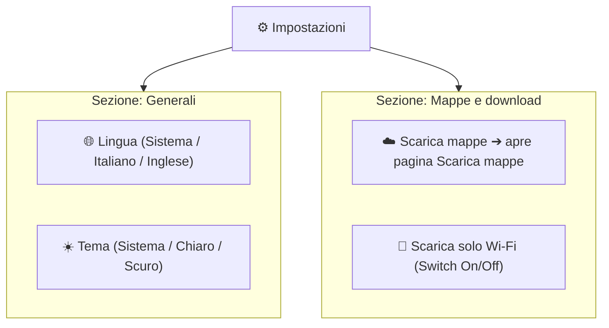
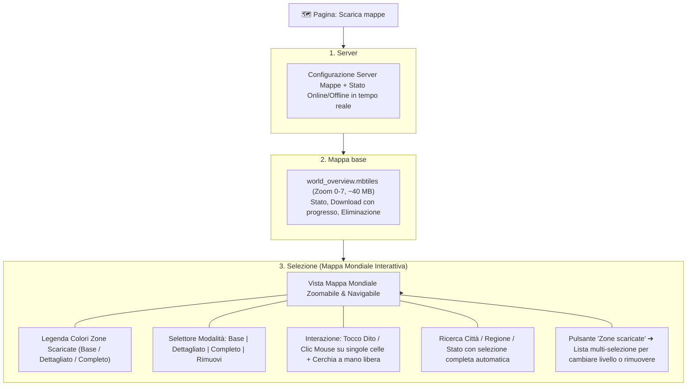

# 06 - Riprogettazione Impostazioni & Hub Unificato "Scarica Mappe"

Questo documento definisce la revisione grafica e funzionale della schermata **Impostazioni** e la nuova architettura unificata della pagina **Scarica mappe** nell'applicazione mobile e desktop **NaRotta**.

---

## 1. Analisi delle Criticità Precedenti e Scelte Progettuali

### 1.1 Verifica Grafica del Bordo delle Card
Dall'ispezione pixel-per-pixel del rendering delle card (`NaCard`) nella schermata Impostazioni sono emersi tre fattori che rendevano il bordo visivamente troppo spesso e marcato:
1. **Contrasto elevato del colore di default in Cupertino**: `NaCard` applicava di default `CupertinoColors.systemGrey4` (`#D1D1D6`), molto più scuro rispetto al colore neutro di confine dell'app (`#E5E7EB` su sfondo `#F3F4F6`).
2. **Anti-aliasing sub-pixel su 2 pixel fisici**: Con il margine implicito di `4.0 px` e fattori di scala desktop/mobile (es. `1.25x`), un bordo centrato finiva a cavallo di due pixel adiacenti (`#E8E9EC` esterno + `#D7D7DC` interno), apparendo largo 2 pixel anziché una linea sottile (*hairline*).
3. **Divisori interni da `1.0 px`**: I separatori orizzontali manuali tra le voci delle card usavano `borderWidthRegular` (`1.0 px`) invece di uno spessore *hairline* (`0.5 px`).

**Soluzione adottata (`AppCard` & `AppCardDivider`)**:
- Introduzione di un componente condiviso `AppCard` basato su `NaCard` con margine azzerato (`EdgeInsets.zero`, perfettamente allineato alle intestazioni di sezione), angoli arrotondati coerenti (`12 px`), assenza di ombre/tinte spurie Material 3 e bordo *hairline* (`0.5 px`) con colore attenuato `AppColors.cardBorder` (`#99E5E7EB` in tema chiaro, `#99374151` in tema scuro).
- Divisori interni `AppCardDivider` ridotti a `0.5 px` con indentazione pulita.

---

### 1.2 Rimozione di "Livelli di dettaglio aggiuntivi" dalle Impostazioni
Nella versione precedente era presente in Impostazioni la sezione *"Livelli di dettaglio aggiuntivi"* (`Edifici 3D (Z13-15)`, `Pedonale e Mobilità Dolce (Z13-15)`, `Rilievi altimetrici HD`).
- **Verifica nel codice**: I flag `includeBuildings3d`, `includePedestrian` e `includeTerrainHd` in `SettingsService` facevano riferimento ai pacchetti `.mbtiles` di **download offline** (`Z13-15`) e non erano collegati alla visualizzazione della mappa.
- Poiché la scelta del livello di dettaglio di download (`Base`, `Dettagliato`, `Completo`) avviene ora contestualmente nella pagina **Scarica mappe**, la sezione risultava ambigua e ridondante ed è stata **rimossa** dalle Impostazioni.

---

## 2. Nuova Struttura della Schermata Impostazioni

La pagina **Impostazioni** è stata semplificata in due sole sezioni essenziali e immediate:

| Sezione | Voce | Tipo Controllo | Comportamento |
| :--- | :--- | :--- | :--- |
| **Generali** | **Lingua** | Selettore modale | Sceglie tra Predefinito di sistema, Italiano e Inglese. |
| **Generali** | **Tema** | Selettore modale | Sceglie tra Predefinito di sistema, Chiaro e Scuro. |
| **Mappe e download** | **Scarica mappe** | Navigazione (`>`) | Apre la pagina unificata **Scarica mappe**. |
| **Mappe e download** | **Scarica solo Wi-Fi** | Interruttore (`NaSwitch`) | Limita il download dei pacchetti cartografici alla sola rete Wi-Fi. |

---

## 3. Pagina Unificata "Scarica Mappe"

La pagina **Scarica mappe** centralizza in un'unica vista tutte le operazioni di configurazione sorgente, mappa panoramica e gestione selettiva delle aree offline, sostituendo le precedenti pagine separate (*Catalogo Regioni* e *Cerchia e Scarica*).

### 3.1 Server
- Mostra l'indirizzo attivo del servizio di distribuzione mappe (`localhost:5001`, `10.0.2.2:5001`, rete LAN `192.168.8.53:5001`, produzione `maps.narotta.app` o URL personalizzato) accompagnato da un badge di stato in tempo reale (**Online** / **Offline**).
- Toccando la card si apre il selettore per cambiare preset o inserire un URL personalizzato, rieseguendo immediatamente il controllo di raggiungibilità (`/health`).

### 3.2 Mappa base
- Gestisce il pacchetto globale `world_overview.mbtiles` (Zoom 0–7, ~40 MB), indispensabile per l'orientamento mondiale e continentale offline.
- Visualizza lo stato corrente (*Non scaricata* con pulsante **Scarica**, *Download in corso* con barra di avanzamento percentuale, oppure *Scaricata* con possibilità di rimozione).

### 3.3 Selezione (Vista Mappa Mondiale Zoomabile)
L'area **Selezione** occupa lo spazio principale della schermata (con possibilità di espansione a schermo intero) e integra cinque funzionalità coordinate sulla griglia universale di celle geografiche `0.5° × 0.5°`:

1. **Zone già scaricate colorate con Legenda**:
   - Ogni cella già presente sul dispositivo viene renderizzata sulla mappa mondiale con il colore corrispondente al livello installato, affiancata da una legenda sempre visibile:
     - **Base** (Blu): Rete stradale e navigazione (`Z8-14`).
     - **Dettagliato** (Ambra): Stradale + sentieri, percorsi pedonali e piste ciclabili (`Z8-16`).
     - **Completo** (Verde): Stradale + sentieri + edifici 3D e rilievi altimetrici HD (`Z8-16`).

2. **Selettore della modalità di download (tutti i livelli + rimuovi)**:
   - Selettore rapido a 4 stati sempre accessibile:
     - **Base**
     - **Dettagliato**
     - **Completo**
     - **Rimuovi**
   - Impostando uno dei tre livelli di dettaglio, il pulsante di conferma avvia il download o l'aggiornamento di livello delle celle selezionate mostrando il peso stimato in MB.
   - Impostando **Rimuovi**, la selezione evidenzia in rosso le celle da eliminare e consente di rimuovere direttamente dalla mappa i dati offline delle aree selezionate.

3. **Selezione con il dito, con il mouse o cerchiando le zone**:
   - **Tocco / Clic puntuale**: toccando con il dito o facendo clic con il mouse su una qualsiasi cella `0.5° × 0.5°`, la cella viene aggiunta o rimossa dalla selezione corrente (attivo sia in modalità *Sposta* che in modalità *Cerchia*).
   - **Cerchia a mano libera (Lasso)**: attivando lo strumento *Cerchia*, è possibile disegnare col dito o trascinare col mouse un perimetro libero attorno all'area desiderata per selezionare tutte le celle intersecate.
   - **Navigazione e Zoom**: supporto completo a *pinch-to-zoom* multi-touch, trascinamento mappa (*Sposta*), rotellina del mouse centrata sul cursore e pulsanti rapidi (`+`, `-`, centra posizione GPS, vista mondo, schermo intero).

4. **Ricerca di Città, Regione o Stato con selezione completa**:
   - Barra di ricerca integrata nella vista Selezione (*"Cerca città, regione o stato..."*) che interroga il catalogo geografico offline (Stati, Regioni amministrative e Città con filtro per poligoni costieri/territoriali).
   - Selezionando un risultato, l'applicazione **seleziona automaticamente tutte le celle** che compongono quella città, regione o nazione e centra/zooma la mappa mondiale sull'area selezionata.

5. **Pulsante Lista delle Zone Scaricate (Modifica livello e Rimozione)**:
   - Un pulsante dedicato (**Zone scaricate**) carica e apre il pannello riepilogativo di tutte le zone attualmente salvate in locale (Stati, Regioni, Città e Aree personalizzate).
   - Dall'elenco l'utente può **selezionare una o più zone** (incluso *Seleziona tutte*) per:
     - **Cambiare il livello di dettaglio** (`Base`, `Dettagliato`, `Completo`) in blocco.
     - **Rimuoverle** dal dispositivo, ricalcolando automaticamente la copertura delle eventuali zone adiacenti o sovrapposte sulla mappa mondiale.

