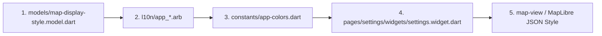

# 🎨 Stili di Visualizzazione Mappa e Gestione Temi (Light / Dark)

Questo documento definisce l'architettura tecnica, le linee guida di implementazione e la roadmap per il rendering e la selezione degli **Stili di Visualizzazione Mappa** (`MapDisplayStyle`) all'interno di **NaRotta**, garantendo il pieno supporto offline e la commutazione dinamica tra **Tema Chiaro (Light)** e **Tema Scuro (Dark)**.

---

## 1. Obiettivi Architetturali

1. **Esperienza Visiva Adattiva**: Fornire all'utente stili cartografici progettati per diversi scenari d'uso (guida tattica/notturna, navigazione urbana, escursionismo/outdoor), senza mai dipendere da connessioni internet esterne.
2. **Supporto Universale Light & Dark**: Qualsiasi stile di mappa implementato deve offrire una variante chiara e una variante scura ad alto contrasto per non affaticare la vista ed evitare abbagliamenti durante la navigazione notturna o in galleria.
3. **Decoupling Motore di Rendering / Stile**:
   - **Canvas CustomPainter (Overview & Mappa Base Offline)**: Utilizzato per il rendering vettoriale planetario z0–z7, la griglia adattiva, la selezione celle e la preview del download.
   - **MapLibre Native (Vector Tiles z8–z15)**: Utilizzato quando le celle regionali dettagliate o complete sono disponibili localmente, consumando fogli di stile MapLibre JSON conformi alla MapLibre Style Specification.
4. **Reattività Istantanea**: La selezione dello stile nelle Impostazioni aggiorna in tempo reale la mappa attiva tramite `ListenableBuilder` / `ChangeNotifier` su `SettingsService`, senza necessità di ricaricare o riavviare l'app.

---

## 2. Modello Dati e Persistenza

### 2.1 Enum `MapDisplayStyle`
Il modello è definito in [`flutter/lib/models/map-display-style.model.dart`](../flutter/lib/models/map-display-style.model.dart):

```dart
/// Defines the available visual cartography styles for map rendering.
enum MapDisplayStyle {
  /// Tactical high-contrast cartography optimized for navigation and orientation.
  tactical,
}
```

Metodi associati:
- `getTitle(AppLocalizations l10n)`: Restituisce il nome localizzato (es. *"Cartografico Tattico"*).
- `getDescription(AppLocalizations l10n)`: Restituisce la descrizione dettagliata dell'uso ideale dello stile.
- `fromName(String? name)`: Metodo robusto di de-serializzazione con fallback sicuro su `MapDisplayStyle.tactical`.

### 2.2 Persistenza in `SettingsService`
In [`flutter/lib/services/settings-service.dart`](../flutter/lib/services/settings-service.dart):
- Chiave di preferenza: `settings_map_display_style`.
- Metodo asincrono: `updateMapDisplayStyleAsync(MapDisplayStyle style)`.
- All'avvio dell'applicazione (`initAsync()`), il valore salvato viene caricato da `SharedPreferences` e notificato ai listener.

---

## 3. Matrice Colori Semantici (Light vs Dark)

Tutti i colori utilizzati nel rendering cartografico sono centralizzati in [`flutter/lib/constants/app-colors.dart`](../flutter/lib/constants/app-colors.dart) e si adattano automaticamente alla `Brightness` del `BuildContext`:

| Elemento Mappa | Metodo `AppColors` | Tema Chiaro (Light) | Tema Scuro (Dark) | Scopo Visivo |
| :--- | :--- | :--- | :--- | :--- |
| **Sfondo Reticolo / Vuoto** | `mapVoid(context)` | `#E2E8F0` (Slate 200) | `#020617` (Slate 950) | Spazio esterno alle terre o privo di mappa |
| **Massa Continentale** | `mapContinent(context)` | `#CBD5E1` (Slate 300) | `#0F172A` (Slate 900) | Terre emerse della mappa base mondiale |
| **Bordo Costiero / Confini** | `mapContinentBorder(context)` | `#94A3B8` (Slate 400) | `#334155` (Slate 700) | Linea di costa e confini nazionali |
| **Dorsali Autostradali** | `mapHighway(context)` | `0xB3D97706` (Ambra calda) | `0x99F59E0B` (Oro brillante) | Spina dorsale arterie principali |
| **Marker Città** | `mapCityMarker(context)` | `#2563EB` (Royal Blue) | `#38BDF8` (Sky Blue) | Punti di riferimento urbani |
| **Etichette Toponomastica** | `mapCityLabel(context)` | `#0F172A` (Slate scuro) | `#F1F5F9` (Slate chiaro) | Nomi città con drop shadow anti-contrasto |
| **Coordinate Principali** | `mapGridMajor(context)` | `0x3364748B` | `0x33475569` | Linee guida griglia principale |
| **Coordinate Secondarie** | `mapGridMinor(context)` | `0x1A94A3B8` | `0x1A334155` | Suddivisione fine 0.5° gradi |
| **Livello Base** | `detailBase(context)` | `#059669` (Smeraldo) | `#10B981` (Smeraldo chiaro) | Confini e viabilità primaria |
| **Livello Dettagliato** | `detailDetailed(context)` | `#2563EB` (Blu) | `#3B82F6` (Blu elettrico) | Strade secondarie, curve, POI base |
| **Livello Completo** | `detailComplete(context)` | `#7C3AED` (Viola) | `#8B5CF6` (Viola chiaro) | Dettaglio pedonale, 3D, grafi Valhalla |

---

## 4. Guida Passo-Passo per Aggiungere un Nuovo Stile

Quando verrà aggiunto un nuovo stile (es. `outdoors` per escursionismo, o `satellite` / `hybrid`), la procedura da seguire è:



### Passo 1: Aggiungere il valore nell'Enum
In `flutter/lib/models/map-display-style.model.dart`:
```dart
enum MapDisplayStyle {
  tactical,
  outdoors, // <-- Nuovo stile
}
```

### Passo 2: Aggiungere le Localizzazioni
Nei file `.arb` (`app_it.arb` e `app_en.arb`):
```json
"mapStyleOutdoorsTitle": "Outdoor ed Escursionismo",
"mapStyleOutdoorsDesc": "Mappa topografica ricca di curve di livello, sentieri e punti di interesse naturali",
```
Eseguire quindi `flutter gen-l10n`.

### Passo 3: Aggiornare il Metodo di Selezione in Impostazioni
In `flutter/lib/pages/settings/widgets/settings.widget.dart`, aggiungere la nuova voce nel modal `_openMapStyleSelectorAsync`:
```dart
NaSelectionItem<MapDisplayStyle>(
  value     : MapDisplayStyle.outdoors,
  title     : Text(MapDisplayStyle.outdoors.getTitle(l10n)),
  subtitle  : Text(MapDisplayStyle.outdoors.getDescription(l10n)),
  isSelected: currentStyle == MapDisplayStyle.outdoors,
),
```

### Passo 4: Definire la Palette o lo Style JSON per MapLibre
Se lo stile è visualizzato nel painter base, aggiungere la logica in `MapGridPainter` / `WorldSelectionPainter`.
Per le vector tiles locali caricate via MapLibre, predisporre i file di stile offline:
- `assets/map-styles/outdoors-light.json`
- `assets/map-styles/outdoors-dark.json`

Questi file JSON referenziano le sorgenti mbtiles locali (`mbtiles://...`) e le cartelle dei font glifi (`assets/fonts/{fontstack}/{range}.pbf`) senza richiedere alcuna connessione di rete.

---

## 5. Mappa Base Mondiale: Autostrade e Città

La mappa base mondiale (`world_overview.mbtiles` o rendering interno a z0–z7) fornisce all'utente un orientamento immediato anche prima di aver effettuato il download delle regioni di dettaglio.

### 5.1 Città e Riferimenti Urbani (`WorldCitiesData`)
Definiti in [`flutter/lib/pages/map-download/widgets/world-cities-data.dart`](../flutter/lib/pages/map-download/widgets/world-cities-data.dart):
- **Tier 1 (Capitali mondiali e metropoli)**: Roma, Parigi, Londra, Berlino, Madrid, Tokyo, New York, Washington, Pechino, Il Cairo, Sydney, Buenos Aires, Mosca, ecc.
  - Visibili a partire da un livello di zoom minimo per orientarsi a livello globale.
- **Tier 2 (Principali città e capoluoghi regionali italiani ed europei)**: Milano, Napoli, Torino, Firenze, Bologna, Venezia, Palermo, Bari, Genova, Verona, Trieste, Cagliari, Monaco, Barcellona, Lione, Zurigo, Vienna, ecc.
  - Vengono renderizzati con toponomastica non appena l'utente ingrandisce la mappa sull'area regionale.

### 5.2 Spina Dorsale Autostradale (`WorldHighwayModel`)
Include le principali direttrici di scorrimento veloce:
- **A1 Autostrada del Sole** (Milano - Bologna - Firenze - Roma - Napoli)
- **A4 Serenissima** (Torino - Milano - Venezia - Trieste)
- **A14 Adriatica** (Bologna - Ancona - Pescara - Bari - Taranto)
- **A2 del Mediterraneo** (Salerno - Cosenza - Reggio Calabria)
- **A22 del Brennero** (Modena - Verona - Trento - Brennero)
- **A10 / A12 Tirrenica** (Genova - Pisa - Livorno)
- **Corridoi Europei** (Parigi-Lione, Madrid-Barcellona, Berlino-Monaco)

Questa rete arteriosa garantisce un continuum visivo naturale tra la mappa panoramica mondiale e le celle ad alto dettaglio scaricate localmente.

