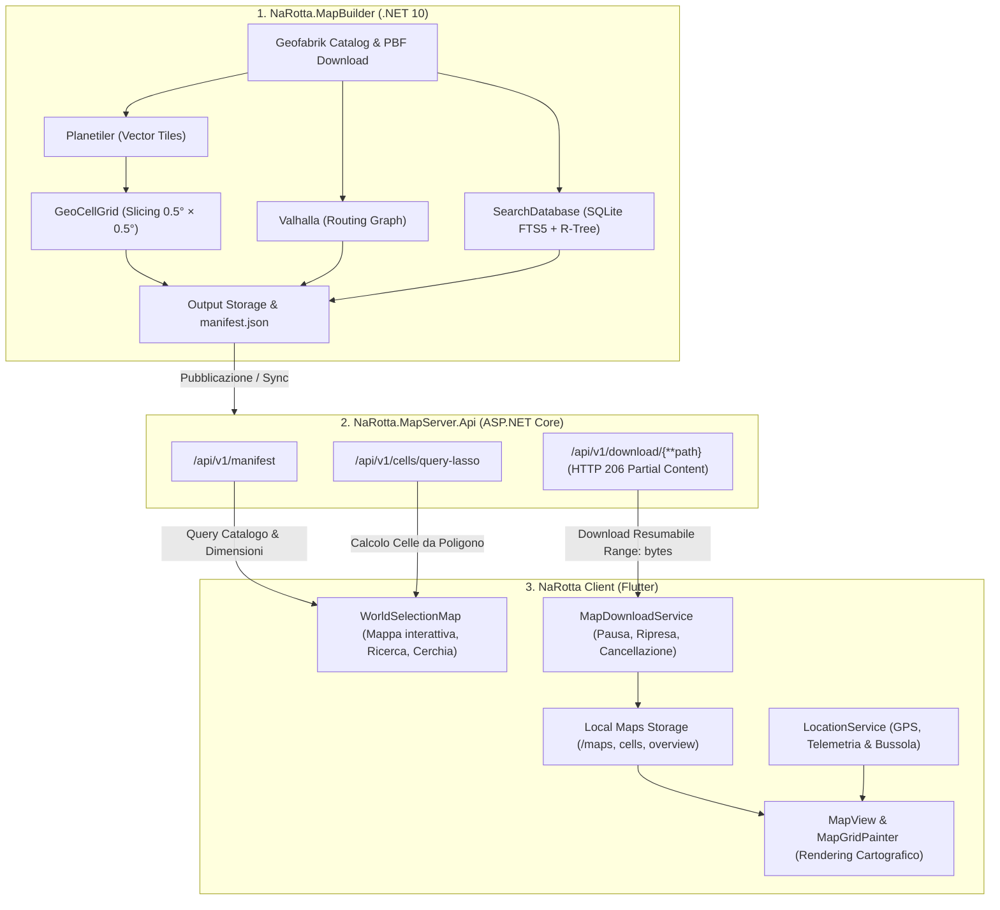

# 🔄 Flusso Operativo End-to-End & Analisi Criticità

Questo documento descrive il **flusso operativo end-to-end** tra i tre sottosistemi di **NaRotta** (`map-builder`, `map-api` e `flutter`), i passaggi del ciclo di vita dei dati cartografici, le criticità risolte e quelle architetturali pianificate per le prossime fasi.

---

## 🏗️ 1. Architettura dei Tre Sottosistemi

---

## ⚙️ 2. Flusso Operativo Passo-Passo

### Fase 1: Generazione & Distribuzione Dati (`map-builder` ➔ `map-api`)
1. **Catalogazione & Download**: `NaRotta.MapBuilder.Cli` o la dashboard Web interrogano il catalogo Geofabrik, scaricano il file `.osm.pbf` e le altimetrie DEM `.hgt`.
2. **Elaborazione Parallela**:
   - Compilazione tile vettoriali base Z8-14, pedonale Z8-16, edifici 3D e curve DEM Z8-16 tramite Planetiler.
   - Slicing automatico delle `.mbtiles` regionali nella griglia mondiale regolare a celle **`0.5° × 0.5°`** (`cell_{latIndex}_{lonIndex}`).
   - Estrazione POI / strade in SQLite compatto con indici FTS5 e R-Tree (`*_search.sqlite`).
   - Compilazione del grafo di navigazione Valhalla (`*_routing.tar`).
3. **Manifest & API Server**: Generazione del file `manifest.json` e avvio del server `NaRotta.MapServer.Api`. Il server espone gli endpoint REST con supporto obbligatorio a **`HTTP 206 Partial Content` (`enableRangeProcessing: true`)**.

### Fase 2: Selezione & Richiesta Offline (`flutter`)
1. **Configurazione Server**: L'utente imposta l'URL del server mappe (es. `localhost:5001`, `10.0.2.2:5001`, LAN o server di produzione).
2. **Selezione Territorio**:
   - **Mappa Panoramica Mondiale**: Download di `world_overview.mbtiles` (Z0-Z7, ~40 MB).
   - **Ricerca Toponimi**: Ricerca offline istantanea di nazioni, regioni o città via `GeoCatalogService`. La selezione risolve le celle `0.5° × 0.5°` che compongono l'area.
   - **Selezione Interattiva**: Tocco su celle singole o disegno a mano libera con lo strumento "Cerchia" (lasso), convertito in lista celle tramite query spaziale.
3. **Livelli di Dettaglio**:
   - `Base`: Stradale completo, toponimi e routing veicolare (Z8-14).
   - `Dettagliato`: Stradale + sentieri escursionistici, percorsi pedonali e piste ciclabili (Z8-16).
   - `Completo`: Stradale + sentieri + edifici 3D volumetrici e curve altimetriche DEM (Z8-16).

### Fase 3: Download Resumabile & Gestione Storage
1. **Download a Blocchi**: `MapDownloadService._downloadBatchFilesAsync` scarica i singoli file `.mbtiles` salvandoli come `.part`.
2. **Pausa e Ripresa (Resumable)**:
   - Se l'utente preme **Pausa**, la connessione si interrompe mantenendo i byte parziali scaricati nel file `.part` e i file `.mbtiles` già completati.
   - Al **Riprendi**, il servizio invia l'header HTTP `Range: bytes=<existingBytes>-`, completando il file senza riscaricare i dati già ricevuti. I file già finalizzati vengono saltati.
3. **Eliminazione e Pulizia**:
   - Alla cancellazione di una zona o di celle selezionate, le directory fisiche `cells/<cellId>/` vengono rimosse dal disco non appena non risultano più referenziate da nessun'altra zona scaricata (`_deleteOrphanedCellFilesAsync`).

---

## 🔍 3. Punti Critici Risolti

| Componente | Criticità Identificata | Soluzione Applicata |
| :--- | :--- | :--- |
| **Flutter / IO** | Path illegale su Windows con caratteri `:` durante download da ricerca (`regions/${place.id}/...`). | Rimosso il percorso ridondante e non valido; il download opera esclusivamente sulle celle `0.5° × 0.5°` risolte. |
| **Flutter / API** | Disallineamento URL per `world_overview.mbtiles` (`overview/...` vs radice). | Allineato il percorso a `world_overview.mbtiles` corrispondente all'albero file del Map Server. |
| **Flutter / UX** | UI bloccata in stato di download perenne dopo sequenza Pausa ➔ Riprendi. | Introdotto `_resumeSelectionActionAsync` con attesa del Future e reset coerente di `_isApplyingAction` e selezione. |
| **Flutter / Download** | Riscaricamento da zero dei file già completati dopo ripresa del batch. | Controllo esistenza file `.mbtiles` non parziali (`lengthSync > 0`), avanzando l'avanzamento senza ri-download. |
| **Flutter / Storage** | File orfani e temporanei `.part` lasciati su disco dopo cancellazioni o annullamenti. | Implementata pulizia ricorsiva `_deleteOrphanedCellFilesAsync` e rimozione `.part` su `cancelDownloadAsync`. |
| **Map Server API** | Mancanza del layer `terrain_hd` nel modello di dettaglio e stima dimensioni delle celle. | Aggiunto mapping `terrain_hd` con URL `_tiles_terrain_hd.mbtiles` e stima byte in `MapDistributionService.cs`. |
| **Map Builder CLI** | Duplicazione di 18 classi sorgente tra `NaRotta.MapBuilder.Cli` e `Core`. | Riferenziato `NaRotta.MapBuilder.Core.csproj` tramite `<ProjectReference>` ed eliminati i file duplicati. |
| **Linee Guida UI** | Colori hardcoded (`Color(...)`) e stringa fissa `'Corso Principale'` in `MapGridPainter`. | Centralizzati in `AppColors` (palette dinamica chiaro/scuro) e localizzazione `mapMainStreetLabel` in `.arb`. |

---

## 🚀 4. Prossimi Passi Architetturali (Roadmap)

1. **Integrazione MapLibre Native (Documento 05)**:
   - Sostituire il rendering procedurale simulato in `MapGridPainter` con la decodifica effettiva dei tile vettoriali `.mbtiles` estratti da SQLite tramite libreria nativa o parser MVT.
2. **Integrazione Database di Ricerca Offline**:
   - Connettere il motore di ricerca dell'app al file `*_search.sqlite` (FTS5 + R-Tree) generato dal Map Builder anziché limitarsi al catalogo statico in-memory.
3. **Integrazione Engine di Routing Offline Valhalla**:
   - Caricare i pacchetti `*_routing.tar` ed eseguire il calcolo percorsi cross-cella / trans-regionale via FFI nativa su dispositivo.
4. **Download Guard Wi-Fi**:
   - Collegare il toggle `SettingsService.wifiOnlyDownload` al controllo dell'interfaccia di rete (`connectivity_plus`) prima di avviare o riprendere i download pesanti.

